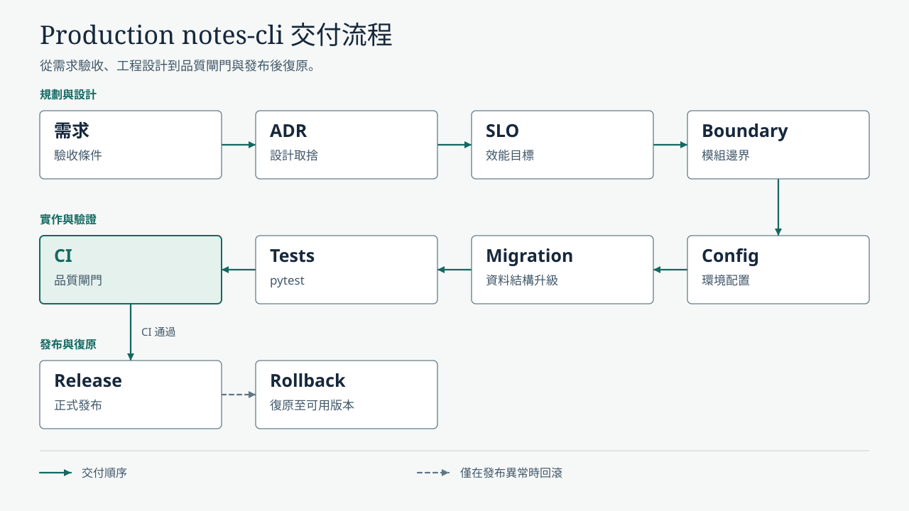
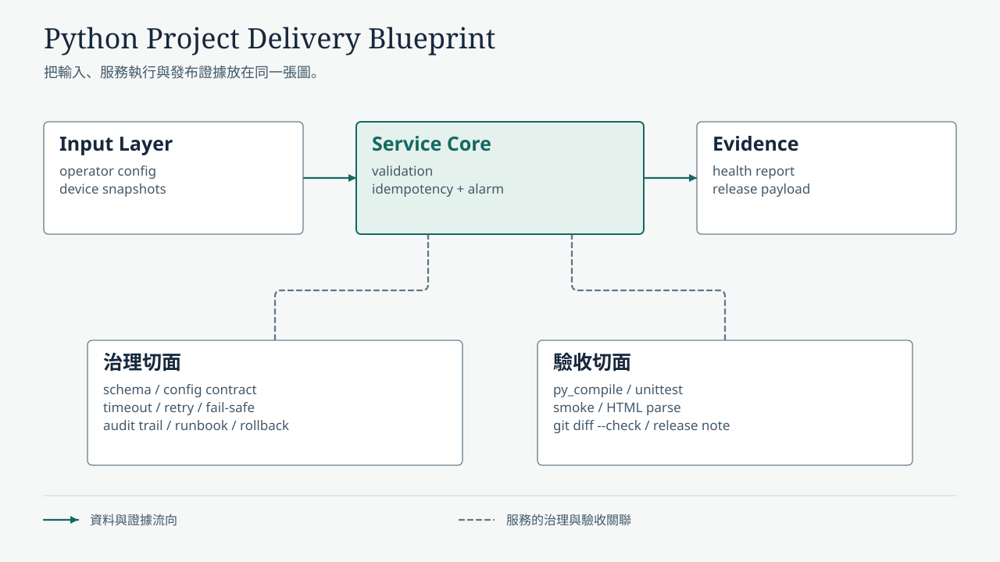

# Python 3.13 語法與新特性完整學習筆記

## 如何使用這份筆記

以 Python 3.15 教材的 16 個核心單元為基礎，使用 Python 3.13 可執行的程式，重新整理本版新增與升級內容。本版重點涵蓋函式作用域、型別參數預設值、型別縮小、佇列關閉。官方文件核對版本 **3.13.18**，功能驗證 **CPython 3.13.15**，整理日期 **2026-11-24（台北）**。

| 你想做什麼 | 閱讀順序 |
|---|---|
| 先把語法學紮實 | C01–C06 認識資料與控制流，C07–C13 練函式、例外與型別，C14–C16 整合工具與 I/O |
| 從舊版升級 | 本版新增與移植 → 並行模型 → 發布檢查 |
| 練一個可交付的小專案 | HVAC 模擬 → 核對預期報告 → 章末練習及驗收 |

## 準備執行環境

```bash
python3.13 --version
python3.13 -m venv .venv
# macOS / Linux
source .venv/bin/activate
# Windows 則用 py -3.13 -m venv .venv
# 並在 PowerShell 執行 .venv\Scripts\Activate.ps1
```

指令中的 `python3.13` 代表該版直譯器。啟用虛擬環境後可用 `python`。範例使用標準函式庫，避免加上 `-O`，以保留驗收用 assertion。本版的 dbm 範例使用 dbm.sqlite3，需安裝含 SQLite 的 CPython。標準庫的 compression.zstd 自 3.14 起提供。

官方來源 [語言參考](https://docs.python.org/3.13/reference/index.html) · [標準函式庫](https://docs.python.org/3.13/library/index.html) · [Python 版本與支援](https://devguide.python.org/versions/)

## 第一部｜核心語法與標準函式庫

### C01｜先讀懂程式的區塊與名稱

本篇整理 **Python 3.13 可以使用的核心語法**。多數功能早在先前版本就已存在；`match`、`dataclass`、`TaskGroup` 與泛型參數語法分別從 3.10、3.7、3.11 與 3.12 開始提供。閱讀順序可分成三段：先學資料與控制流程，再學函式與物件，最後學例外、型別、模組與非同步。

Python 以縮排界定區塊。`if`、`for`、`def`、`class` 等敘述的標頭以冒號結束，其內文增加一層縮排。工程專案通常每層使用四個空白；四個是風格慣例，真正的語法要求是區塊層級一致。不要混用 tab 與空白。括號內可自然換行，通常比行尾反斜線更易維護。

```python
supply_c = 7.2
return_c = 12.1

if return_c - supply_c >= 4.0:
    message = (
        "冰水溫差符合本次範例條件："
        f"{return_c - supply_c:.1f} °C"
    )
    print(message)
```

名稱區分大小寫；`pump_id` 與 `Pump_ID` 是不同名稱。名稱不能以數字開頭。Python 允許部分 Unicode 字元作為識別字，但混用形似字元會增加審查難度；設備代號與函式名稱宜維持一致的命名規範。`#` 開始行內註解；函式、類別或模組的第一個字串可成為 docstring，供 `help()` 與工具讀取。三引號字串本身不是一般註解語法。

`class`、`return`、`None` 等保留字不能拿來當一般變數。soft keyword 只在特定語境具有語法意義，例如 `match`、`case`、`_` 與 `type` 的相關用法；完整清單應直接查目前的直譯器，避免把不同版本的清單混用。內建名稱如 `list`、`str` 並非保留字，卻不宜被同名變數遮蔽。

```python
import keyword

print(keyword.iskeyword("class"))       # True
print(keyword.issoftkeyword("match"))   # True
print(keyword.kwlist)
print(keyword.softkwlist)
```

官方來源：[詞彙分析](https://docs.python.org/3.13/reference/lexical_analysis.html)、[keyword](https://docs.python.org/3.13/library/keyword.html)。

### C02｜數值、字串、f-string 與 bytes

`int` 適合計數、位址與位元遮罩；其大小受可用記憶體限制，沒有固定的 32 位元或 64 位元上限。`float` 適合一般連續量計算，但以二進位浮點表示，部分十進位小數無法精確保存。`complex` 可表示複數。`bool` 表示真假，雖然與整數有繼承關係，資料驗證仍應明確區分「數值讀值」與「開關狀態」。

```python
import math
from decimal import Decimal

raw_count = 12_500
register = 0x20
ratio = 3 / 2                 # 1.5
whole = -3 // 2               # -2，向負無限大取整
close = math.isclose(0.1 + 0.2, 0.3)
bill = Decimal("0.1") + Decimal("0.2")
```

`Decimal("0.1")` 從十進位文字建立精確的十進位值；若先寫成浮點數，再交給 `Decimal`，原先的近似值也會被帶入。浮點比較宜依問題設定相對與絕對容差，尤其在接近零的讀值附近。`round()` 與輸出格式化是不同操作：`f"{value:.1f}"` 只決定文字如何呈現，沒有修改原本讀值。

`str` 保存文字；單引號、雙引號在基本用途上等價。`\n`、`\t` 等跳脫序列用來表達特殊字元；raw string 如 `r"C:\logs\ahu"` 適合少寫反斜線，但不能以奇數個反斜線結尾。字串不可變，`replace()`、`strip()` 等通常回傳新字串。字串索引以 Unicode 碼點為基礎，畫面上一個可見字形不一定等於一個索引單位。

```python
point = "T10"
value = 24.375
label = f"{point}: {value:.1f} °C"   # T10: 24.4 °C
debug = f"{point=}, {value=}"       # 顯示名稱與值
literal = f"{{point}} = {point}"   # 雙大括號表示文字大括號

payload = "送風溫度".encode("utf-8")
text = payload.decode("utf-8")
frame = bytes([1, 3, 0, 32])
first_byte = frame[0]              # 1，索引結果是整數
```

`bytes` 是不可變的位元組序列，`bytearray` 則可修改。文字與位元組的轉換必須指定合適編碼；通訊封包的二進位欄位不是一般文字，不能一律 `decode()`。解讀多位元組整數時要另行確認 byte order、signed 與欄位長度，例如 `int.from_bytes(frame[2:4], "big")`。

官方來源：[數值與字串入門](https://docs.python.org/3.13/tutorial/introduction.html)、[輸出格式化](https://docs.python.org/3.13/tutorial/inputoutput.html)、[內建型別](https://docs.python.org/3.13/library/stdtypes.html)、[浮點限制](https://docs.python.org/3.13/tutorial/floatingpoint.html)、[decimal](https://docs.python.org/3.13/library/decimal.html)。

### C03｜名稱繫結、可變性與複製

`a = b` 把名稱 `a` 繫結到 `b` 所參照的物件，不代表複製資料。函式收到的引數同樣涉及物件參照：修改共用串列，呼叫端會看到；把函式內的參數改綁到另一個串列，則不會替呼叫端重新賦值。先分清楚「改物件」與「改名稱」，比背誦傳值或傳址更準確。

```python
from copy import deepcopy

original = {"AHU01": {"setpoint": 24.0}}
alias = original
shallow = original.copy()
deep = deepcopy(original)

original["AHU01"]["setpoint"] = 25.0
print(alias["AHU01"]["setpoint"])    # 25.0
print(shallow["AHU01"]["setpoint"])  # 25.0
print(deep["AHU01"]["setpoint"])     # 24.0
```

淺複製建立新的外層容器，但裡面的巢狀物件仍可共用。深複製會遞迴複製可複製的內容，代價與語意也不同；連線、檔案等外部資源不能當成一般資料隨意複製。建構設定快照時，應先決定哪些欄位要獨立，再選擇複製方式。

`list`、`dict`、`set` 一般可變；數字、`str`、`bytes`、`tuple` 一般不可變。但「tuple 不可變」只限制其元素參照，並不會把內部串列凍結：`([1],)` 裡的串列仍能 `append()`。`==` 比較值；`is` 比較是否同一物件。判斷缺值使用 `value is None`，不要依靠小整數或字串駐留的偶然結果。

另一個常見陷阱是 `rows = [[0] * 3] * 2`：兩列指向同一個內層串列。建立獨立二維資料應用 `[[0] * 3 for _ in range(2)]`。`del name` 解除名稱繫結，不代表所有引用該物件的名稱都消失，也不是外部資源即時關閉的保證。

官方來源：[物件資料模型](https://docs.python.org/3.13/reference/datamodel.html)、[淺複製與深複製](https://docs.python.org/3.13/library/copy.html)。

### C04｜運算子與優先序速查

運算子的行為與物件型別有關；例如 `+` 可以數值相加，也可以串接字串，`|` 可用於整數位元運算、集合聯集或字典合併。先確認操作對象，再解讀符號。

| 類別 | 語法 | 工程資料用途與提醒 |
|---|---|---|
| 算術 | `+ - * / // % **` | 加減乘除、整除、餘數與次方；`//` 不是一律朝零截斷 |
| 矩陣乘法 | `@` | 由支援此協定的型別提供；一般數字與串列不直接提供矩陣運算 |
| 比較 | `== != < <= > >=` | `0 <= valve <= 100` 是合法鏈式比較 |
| 邏輯 | `and or not` | 具有短路求值；`and`、`or` 可回傳運算元，不保證是 bool |
| 成員 | `in`、`not in` | `"T10" in readings` 對字典檢查的是鍵 |
| 身分 | `is`、`is not` | 比較同一物件；適合 `x is None` |
| 位元 | `& \| ^ ~ << >>` | 解析狀態字、旗標與遮罩 |
| 條件運算式 | `a if condition else b` | 選擇一個結果，兩個分支不會一起求值 |
| 賦值運算式 | `:=` | 在運算式中繫結名稱，需注意括號與可讀性 |
| 增強賦值 | `+= -= *=` 等 | 可能就地修改物件，不能一概當成建立新物件 |

常見優先序由高到低，可依下表查閱；同層大多由左向右結合，次方與條件運算式有不同結合規則。

| 由高到低 | 項目 |
|---|---|
| 1 | 括號分組、索引、切片、呼叫、屬性存取 |
| 2 | `await` |
| 3 | `**` |
| 4 | 一元 `+`、`-`、`~` |
| 5 | `* / // % @` |
| 6 | `+ -` |
| 7 | `<< >>` |
| 8 | `&`，接著 `^`，再接著 `\|` |
| 9 | 比較、`in`、`not in`、`is`、`is not` |
| 10 | `not`，接著 `and`，再接著 `or` |
| 11 | `a if condition else b` |
| 12 | `lambda` |
| 13 | `:=` |

`-2**2` 等於 `-(2**2)`，結果是 `-4`；`2**-2` 則允許右側負指數，結果為 `0.25`。複合位元條件建議寫成 `(status & 0b1000) != 0`，讓審查者直接看出遮罩範圍。`=` 是賦值敘述的語法，不是上述運算式優先序的一員。

```python
status = 0b1010
fan_proven = (status & 0b0010) != 0
has_alarm = (status & 0b1000) != 0
state = "異常" if has_alarm else "正常"

reading = 0.0
wrong_default = reading or 24.0          # 得到 24.0，吞掉有效零值
safe_default = 24.0 if reading is None else reading
```

官方來源：[運算式與優先序](https://docs.python.org/3.13/reference/expressions.html)、[布林運算與比較](https://docs.python.org/3.13/library/stdtypes.html)。

### C05｜容器、切片、解包與推導式

| 容器 | 典型資料 | 關鍵行為 |
|---|---|---|
| `list` | 按時間排列的溫度 | 有順序、可修改，可含重複值 |
| `tuple` | 一筆 `(point, value)` | 有順序、元素參照不可修改；單元素需逗號 `(7.2,)` |
| `dict` | 點位名稱對讀值 | 依鍵查找，保存插入順序；鍵需可雜湊 |
| `set` | 本輪離線設備集合 | 元素唯一；不應依賴迭代順序 |
| `frozenset` | 不變的點位集合 | 不可修改，可用於需要可雜湊集合的場合 |

空字典是 `{}`，空集合是 `set()`。字典缺鍵時 `d[key]` 會拋出 `KeyError`；`d.get(key)` 可回傳預設值，但要分辨「不存在」與「存在且值為 None」。修改方法如 `list.append()`、`list.sort()` 通常回傳 `None`；不要寫 `values = values.sort()`。

```python
values = [23.5, 24.0, 24.5, 25.0]
latest = values[-1]
recent = values[-2:]              # [24.5, 25.0]
alternate = values[::2]           # [23.5, 24.5]
reversed_values = values[::-1]
first, *middle, last = values

points = ["T10", "T11", "T12", "T13"]
readings = dict(zip(points, values, strict=True))
hot = {point: value for point, value in readings.items() if value >= 24.5}
rounded = [round(value, 1) for value in values]
unique_values = {value for value in values}
```

切片採 `start:stop:step`，`stop` 不包含在結果中。一般序列切片會容許超出邊界的範圍，但直接索引仍可能拋出 `IndexError`；步長不能是零。`a[:]` 對串列是淺複製，不會複製巢狀內容。解包時，星號目標會取得其餘項目形成的串列；沒有星號時，左右項目數必須符合。

`[*old, new]` 展開 iterable，`{**defaults, **overrides}` 合併 mapping，後面的同名鍵覆寫前面。函式呼叫的 `**kwargs` 則不容許把同一個參數值重複提供兩次。推導式適合清楚的轉換與篩選；兩三層巢狀且包含副作用時，改成一般迴圈比較容易除錯。`(x * 2 for x in values)` 是惰性產生器運算式，不會立刻建出完整串列。

官方來源：[資料結構](https://docs.python.org/3.13/tutorial/datastructures.html)、[zip 與內建函式](https://docs.python.org/3.13/library/functions.html)。

### C06｜if、match、迴圈與迴圈 else

`if` 由上而下檢查條件，只執行第一個成立分支。空容器、零、`None` 等通常視為假，但缺值與有效零值常有不同業務意義。監控資料最好先處理缺值，再比較上下限；對可能含 `NaN` 的浮點資料，還要明確決定無效值策略。

```python
def classify_temperature(value):
    if value is None:
        return "missing"
    elif value >= 28.0:
        return "high"
    else:
        return "normal"
```

`match` 是結構模式比對，能檢查字典、序列、常值與型別結構，不只是多分支 `if` 的縮寫。guard 是模式成功後的額外條件。一般裸名稱在模式裡通常是捕捉變數，不是讀取既有常數；常數比對可用字面值或帶限定名稱的屬性。`_` 表示不擷取該部分。

```python
def describe_event(event):
    match event:
        case {"kind": "temperature", "value": float(value)} if value >= 28:
            return f"高溫 {value:.1f} °C"
        case {"kind": "offline", "device": device}:
            return f"{device} 離線"
        case _:
            return "其他事件"
```

此處 `float(value)` 是類別模式，用來比對浮點物件並擷取其值，不會替字串執行 `float()` 轉型。字典模式預設允許額外鍵；若需求必須拒絕未知欄位，應另外驗證。模式也不會自動保證數值位於工程量程內。

`for` 逐項取得 iterable 的內容；`range(3)` 產生 `0、1、2`。需要索引時使用 `enumerate()`，平行走訪資料時使用 `zip()`，並在兩側長度應相同時考慮 `strict=True`。`while` 在每輪開始檢查條件；`break` 結束最近一層迴圈，`continue` 跳到下一輪，`pass` 則是不執行任何操作的佔位敘述。

```python
readings = {"T10": 24.0, "T11": 25.5}
for point, value in readings.items():
    if value > 28.0:
        print("第一個高溫點", point)
        break
else:
    print("本輪沒有找到高溫點")
```

迴圈的 `else` 在迴圈正常耗盡或條件變假時執行；`break` 會跳過它。它不是「最後一輪 if 沒成立」。如果用 `return` 或例外離開，也不會走到這個 `else`。走訪字典時增刪鍵容易出錯；可先建立待刪清單或新的篩選結果。

官方來源：[控制流程教學](https://docs.python.org/3.13/tutorial/controlflow.html)、[複合敘述與模式比對](https://docs.python.org/3.13/reference/compound_stmts.html)。

### C07｜函式參數：位置、關鍵字、可變引數

函式把輸入轉成輸出，讓讀值解析、單位換算與狀態判斷可以各自驗證。`return` 立即離開函式；沒有明確回傳值時結果是 `None`。`return value, quality` 是回傳一個 tuple，而不是建立兩條獨立輸出通道。函式定義也會建立物件，因此函式可被傳入、回傳或放進容器。

```python
def summarize(device, /, offset=0.0, *samples, unit="°C", **metadata):
    """回傳指定設備的平均讀值摘要。"""
    if not samples:
        raise ValueError("至少需要一筆讀值")
    mean = sum(samples) / len(samples) + offset
    return {"device": device, "mean": mean, "unit": unit, "metadata": metadata}

summary = summarize("AHU01", 0.2, 24.0, 26.0, unit="°C", floor=3)
```

| 參數位置 | 範例 | 呼叫規則 |
|---|---|---|
| `/` 前 | `device` | 只能以位置提供 |
| `/` 後、`*` 前 | `offset` | 可用位置或關鍵字 |
| `*samples` | 多筆讀值 | 接收其餘位置引數，形成 tuple |
| `*samples` 或裸 `*` 後 | `unit` | 只能以關鍵字提供 |
| `**metadata` | 額外欄位 | 接收其餘關鍵字引數，形成 dict |

如果不需要接收任意位置引數，可寫 `def convert(raw, /, *, scale=0.1): ...`。已經有 `*samples` 時，不再額外放裸 `*`。呼叫端的 `*values` 與 `**options` 是展開資料，定義端的星號則描述收集或限制參數，兩者要分開理解。

一般預設值在執行 `def` 建立函式時求值，不是每次呼叫重新建立。`def collect(value, history=[]): ...` 會讓多次呼叫共用同一串列。通常改成 `history=None`，進入函式後才建立新串列；若 `None` 本身也是合法且需區分的輸入，可自行建立唯一標記物件。

```python
def collect(value, history=None):
    if history is None:
        history = []
    history.append(value)
    return history

ranked = sorted([("T10", 25.0), ("T11", 23.0)], key=lambda item: item[1])
```

`lambda` 建立只有一個運算式的匿名函式，適合簡短排序鍵。包含多步驗證、重試或副作用的工作，應使用具名稱與 docstring 的 `def`。函式參數註記不會自動將字串轉為數字，也不會自動拒絕錯誤型別；檢查責任仍要明確安排。

官方來源：[函式與特殊參數](https://docs.python.org/3.13/tutorial/controlflow.html#special-parameters)、[函式定義](https://docs.python.org/3.13/reference/compound_stmts.html#function-definitions)。

### C08｜LEGB、閉包與裝飾器

一般函式名稱查找可先用 LEGB 理解：Local 是目前函式；Enclosing 是外層函式；Global 是所在模組；Builtins 是內建名稱。函式內只要存在對某名稱的賦值，通常就會把它視為區域名稱；在賦值前讀取，可能得到 `UnboundLocalError`。`if` 與一般 `for` 區塊不會像函式一樣另建區域作用域。

`global` 讓賦值作用於模組名稱，並不是宣告整個應用程式共同的全域變數。`nonlocal` 讓內層函式重新繫結最近外層函式的既有名稱。修改外層串列內容與重新繫結外層名稱不同；前者不一定需要 `nonlocal`。類別與型別參數另有作用域規則；方法內取得實例屬性應寫 `self.name`，不能把類別本體當成一般 enclosing function。

```python
def make_counter():
    count = 0
    def increment():
        nonlocal count
        count += 1
        return count
    return increment

counter = make_counter()
print(counter(), counter())   # 1 2
```

閉包保存對外層名稱的存取，並非自動保存建立瞬間的數值。迴圈中建立多個 `lambda: i`，之後呼叫時通常讀到同一個最後值。需要固定當時資料，可使用工廠函式，或像 `lambda i=i: i` 這樣把當時值放進預設參數。讀取閉包狀態時也要考量它是否被其他呼叫修改。

裝飾器接收一個函式或類別，再回傳替代物件。`@audit` 放在函式上方，大致相當於定義後執行 `fn = audit(fn)`；多層裝飾器從貼近函式的一層開始套用。使用 `functools.wraps` 保存名稱、docstring 等資訊，有助於追查與產生說明。

```python
from functools import wraps

def audit(fn):
    @wraps(fn)
    def wrapper(*args, **kwargs):
        result = fn(*args, **kwargs)
        return {"operation": fn.__name__, "result": result}
    return wrapper

@audit
def normalize(raw):
    return raw / 10.0

print(normalize(245))  # {'operation': 'normalize', 'result': 24.5}
```

這個裝飾器刻意改變回傳格式，呼叫端必須知道新的契約。工程程式使用裝飾器時，應檢查它是否改變例外、回傳型別與呼叫時機，不能只看被包覆的函式本體。

官方來源：[執行與名稱解析模型](https://docs.python.org/3.13/reference/executionmodel.html)、[functools.wraps](https://docs.python.org/3.13/library/functools.html#functools.wraps)。

### C09｜class、dataclass 與物件協定

類別把狀態與操作放在同一個物件裡。`self` 是慣用的實例參數名稱；呼叫 `obj.method()` 時，物件會成為方法的第一個引數。`__init__()` 負責初始化已建立的實例，不能回傳另一個物件。類別屬性由實例共享；每個設備各自的讀值串列通常應在 `__init__()` 建立。

```python
from dataclasses import dataclass, field

@dataclass
class DeviceSnapshot:
    device: str
    temperature_c: float
    alarms: list[str] = field(default_factory=list)

    @property
    def temperature_f(self):
        return self.temperature_c * 9 / 5 + 32

    @classmethod
    def from_raw(cls, device, raw):
        return cls(device, raw / 10.0)

    @staticmethod
    def valid_name(name):
        return bool(name) and name.isascii()
```

`dataclass` 可依欄位產生初始化、表示與相等比較等方法；`default_factory=list` 讓每個實例有自己的串列。`frozen=True` 阻止一般欄位重新賦值，但不會遞迴凍結欄位裡的串列。它也不是輸入驗證器：註記 `float` 不會自動拒絕字串。`property` 讓計算或受控存取具有屬性外觀；唯讀 property 沒有 setter，但其他可變欄位仍可被改動。

`classmethod` 接收類別 `cls`，適合替代建構入口，繼承時也能建立子類別實例。`staticmethod` 不接收隱含 `self` 或 `cls`，適合與類別概念相關但不依賴實例狀態的小工具。若工具與類別關係不強，直接用模組函式通常更容易發現。

```python
class Sensor:
    def __init__(self, name):
        self.name = name

class CalibratedSensor(Sensor):
    def __init__(self, name, offset):
        super().__init__(name)
        self.offset = offset
```

`super()` 沿著方法解析順序呼叫下一個實作，在多重繼承裡不等於固定指定某個父類別。多重繼承若要合作，方法簽章與 `super()` 呼叫方式必須配合。一般組合關係，如「監控服務有一個感測器」，常可先用物件持有另一物件表達，不必急著使用繼承。

| 特殊方法 | 對應操作 | 設計用途 |
|---|---|---|
| `__repr__` | `repr(obj)` | 提供可辨識的診斷表示 |
| `__str__` | `str(obj)` | 面向讀者的文字 |
| `__len__` | `len(obj)` | 容器長度 |
| `__iter__`、`__next__` | `for`、`next()` | 可迭代與迭代器協定 |
| `__getitem__` | `obj[key]` | 索引或鍵存取 |
| `__eq__`、`__hash__` | 相等與雜湊 | 設計鍵物件時須維持一致性 |
| `__enter__`、`__exit__` | `with` | 資源取得與釋放 |
| `__call__` | `obj(...)` | 讓實例成為可呼叫物件 |

這些方法構成物件協定，讓自訂型別融入 Python 語法；不要只因為可以就替設備物件塞入所有運算子。可變物件若用作字典鍵，還要避免相等或雜湊依據在存放期間改變。

官方來源：[類別教學](https://docs.python.org/3.13/tutorial/classes.html)、[dataclasses](https://docs.python.org/3.13/library/dataclasses.html)、[特殊方法](https://docs.python.org/3.13/reference/datamodel.html)、[property、classmethod、staticmethod、super](https://docs.python.org/3.13/library/functions.html)。

### C10｜迭代器、yield 與 yield from

iterable 是能提供迭代器的物件；iterator 是保存目前進度、能被 `next()` 推進的物件。`iter(values)` 取得迭代器，耗盡後會拋出 `StopIteration`。串列可反覆建立新的迭代器，而同一個產生器通常只能走訪一次；把它傳給 `sum()` 後，後續再走訪可能已沒有資料。

```python
def valid_values(rows):
    for row in rows:
        value = row.get("value")
        if value is not None:
            yield float(value)

rows = [{"value": "24.1"}, {"value": None}, {"value": "25.3"}]
stream = valid_values(rows)
print(next(stream))       # 24.1
print(list(stream))       # [25.3]
print(list(stream))       # []
```

函式包含 `yield` 時，呼叫它會取得產生器；函式本體等到迭代時才前進。每次 `yield` 暫停並保留區域狀態，適合逐筆解析趨勢檔。這不表示每筆資料一定即時從硬體讀取，實際資料來源仍由函式內容決定。產生器也可能在消費到特定資料時才拋出轉型例外。

`yield from iterable` 把迭代工作委派給另一個 iterable。它除了逐項轉交值，也支援產生器間的 `send()`、`throw()`、關閉與回傳值傳遞；基礎資料串流先掌握逐項委派即可。

```python
def merge_batches(batches):
    for batch in batches:
        yield from batch

print(list(merge_batches([[24.0, 25.0], [26.0]])))
```

惰性處理可減少中間容器，但不是所有來源都會自動節省記憶體：如果讀檔前已把整個檔案放進串列，後段再包成產生器，前段配置仍然存在。`itertools.islice()`、`chain()`、`pairwise()` 可支援分段、串接與相鄰差值；需要排序的步驟則通常必須先蒐集相應資料。

官方來源：[迭代器與產生器](https://docs.python.org/3.13/tutorial/classes.html#iterators)、[yield 運算式](https://docs.python.org/3.13/reference/expressions.html#yield-expressions)、[itertools](https://docs.python.org/3.13/library/itertools.html)。

### C11｜例外、原因鏈與 ExceptionGroup

例外讓正常結果與失敗路徑分開。`try` 只包住預期可能失敗、且此處知道如何處理的操作；捕捉太大一段程式，容易把程式錯誤誤認為輸入問題。多個 `except` 由上而下尋找相符類別，具體例外通常放在一般例外之前。沒有合適處理者時，例外會沿呼叫鏈往外傳。

```python
class InvalidReading(ValueError):
    pass

def parse_temperature(raw):
    try:
        value = float(raw)
    except (TypeError, ValueError) as exc:
        raise InvalidReading(f"無法解析溫度：{raw!r}") from exc
    else:
        return value
    finally:
        pass  # 若此函式取得資源，必要清理應明確放在這裡
```

`else` 放在 `try` 正常完成時才執行的工作；這裡發生的例外不會被前面的 `except` 再捕捉。`finally` 在正常或例外離開時執行，適合必要清理；不要在其中用 `return` 蓋掉原本的回傳或例外。突然終止行程、斷電等情況也不屬於語言清理保證。

`raise` 可重新拋出正在處理的例外，`raise NewError(...) from exc` 明確保留根本原因。`from None` 只抑制顯示中的原因鏈，不會修復錯誤。`except Exception` 不包含所有 `BaseException` 子類別；中斷、退出與取消有自己的控制意義，不宜無差別吞掉。`assert` 適合開發時檢查不變量，但可能因最佳化選項被移除，不能取代外部輸入驗證。

```python
failures = [ValueError("T10 格式錯誤"), TimeoutError("AHU02 逾時")]
try:
    raise ExceptionGroup("本輪採樣失敗", failures)
except* ValueError as group:
    print("資料格式失敗數", len(group.exceptions))
except* TimeoutError as group:
    print("逾時數", len(group.exceptions))
```

`ExceptionGroup` 表達多個失敗，`except*` 會依其中的例外分組處理，因此同一次處理可執行不只一個分支。未處理的部分仍往外傳。同一個 `try` 不能混放 `except` 與 `except*`；也不能在 `except*` 區塊中使用 `return`、`break` 或 `continue`。群組可以巢狀，`len(group.exceptions)` 只計算直接子項，不能一律當作全部葉節點失敗數。

官方來源：[例外教學](https://docs.python.org/3.13/tutorial/errors.html)、[例外類別與原因鏈](https://docs.python.org/3.13/library/exceptions.html)、[except* 規則](https://docs.python.org/3.13/reference/compound_stmts.html#except-star)。

### C12｜with 與 contextmanager：把生命週期寫進結構

`with` 用來描述進入與離開某個資源範圍。檔案、鎖與某些連線物件支援這個協定。進入時呼叫 `__enter__()`；成功進入後離開區塊時呼叫 `__exit__()`，並把例外資訊交給它。`__exit__()` 回傳真值可抑制例外，因此閱讀自訂 context manager 時要確認它是否吞掉失敗。

```python
from contextlib import contextmanager
from pathlib import Path
from tempfile import TemporaryDirectory

@contextmanager
def temporary_output(directory):
    with TemporaryDirectory(dir=directory) as owned_dir:
        yield Path(owned_dir) / "snapshot.tmp"
```

`TemporaryDirectory` 先建立本次工作專用的目錄，離開時只清理該目錄裡的資源。清理責任應跟著資源的建立與擁有關係安排。

用 `@contextmanager` 包裝的產生器應恰好 `yield` 一次。`yield` 前準備資源，交出的值成為 `as` 後的名稱，離開區塊後繼續執行清理。若區塊內拋出例外，例外會在產生器的 `yield` 位置重新出現；只想記錄而不想吞掉時，處理後須再 `raise`。

把資源生命週期放進 `with`，呼叫端較不容易漏掉關閉。多個 context manager 可放在同一個 `with`，退出順序與進入相反。進入第二個資源失敗時，已成功進入的第一個仍能退出。需要動態數量的資源時，可查 `contextlib.ExitStack`；不必手工堆疊多層 `try/finally`。

官方來源：[contextlib](https://docs.python.org/3.13/library/contextlib.html)、[with 敘述](https://docs.python.org/3.13/reference/compound_stmts.html#the-with-statement)。

### C13｜typing：說清楚資料契約

型別註記服務於閱讀、編輯器與靜態檢查工具；Python 不會僅因有註記，就在執行時強制驗證資料。`list[float]` 描述元素型別，`float | None` 表示可能缺值。允許 `None` 與「呼叫時可以省略參數」是兩件事，後者仍需要預設值。

```python
from collections.abc import Sequence
from typing import Protocol, TypedDict

type PointMap = dict[str, float]

def first[T](items: Sequence[T]) -> T:
    if not items:
        raise ValueError("序列不可為空")
    return items[0]

class SampleBox[T]:
    def __init__(self, value: T):
        self.value = value

class Reader(Protocol):
    def read(self, point: str) -> float: ...

class Reading(TypedDict):
    point: str
    value: float
    quality: str
```

`type PointMap = ...` 是型別別名；`T` 讓輸入與輸出的型別關係得以保留，例如 `first()` 回傳輸入序列的元素型別。泛型是描述關係，不代表 Python 會自動產生每種型別的特化機器碼。別名也不等於新增一種執行時數值型別，不能直接把型別別名當作 `isinstance()` 的一般類別參數。

`Protocol` 描述「提供哪些成員就能合作」，適合把監控邏輯與不同通訊實作分開；符合介面的類別不必明確繼承它。`TypedDict` 則描述字典欄位，執行時仍是普通 dict，不會自動檢查缺鍵、額外鍵或型別。需要驗證外部 JSON 時，仍須撰寫解析與檢查。

`Any` 讓檢查器容許動態操作，會減少型別保證；`object` 表示型別未知，但使用前須先確認支援的操作。接收未知外部輸入時，用 `object` 配合 `isinstance()` 縮小型別，通常比較能保留檢查價值。`isinstance(value, (int, float))` 也會接受 bool；若業務規則不接受布林數字，應明確排除。

官方來源：[typing](https://docs.python.org/3.13/library/typing.html)、[泛型與型別參數](https://docs.python.org/3.13/reference/compound_stmts.html#type-parameter-lists)。

### C14｜模組、import、入口與環境管理

一個 `.py` 檔通常就是一個模組；模組讓程式依責任分工，例如解析、計算、報表與入口。`import math` 將模組名稱帶入目前作用域，`from math import isclose` 則帶入指定名稱。一般匯入會執行模組頂層敘述並利用模組快取；頂層因此宜放定義與必要初始化，不要在被匯入時意外啟動長期採集工作。

```python
# 假設此檔名為 report_cli.py

def main() -> int:
    print("產生監控摘要")
    return 0

if __name__ == "__main__":
    raise SystemExit(main())
```

直接執行檔案時，入口模組名稱是 `__main__`。`python -m package.module` 以模組方式啟動，通常更適合套件內的相對匯入。不要把自己的檔案命名為 `json.py`、`typing.py` 等常用標準庫名稱，以免搜尋路徑優先找到自己的檔案。`from module import *` 會讓來源不清楚，維護時通常使用明確匯入。

```bash
python3.13 -m venv .venv
# macOS / Linux
.venv/bin/python -m pip --version
.venv/bin/python report_cli.py
# Windows 對應直譯器：.venv\Scripts\python.exe
```

虛擬環境隔離專案套件，不是容器或權限隔離機制。它通常應在目標系統依依賴宣告重新建立，而非直接搬移整個目錄。使用 `python -m pip` 能讓安裝工具與目前選定的直譯器一致；啟用環境是方便的 PATH 調整，直接使用環境內的 Python 路徑也能工作。

`pyproject.toml` 放專案與工具設定：`[build-system]` 描述建置後端及建置依賴，`[project]` 放名稱、版本、支援的 Python 範圍與執行依賴，`[tool.*]` 放個別工具選項。它不是 Python 執行語法，也不會單憑檔案存在就安裝依賴或鎖定所有間接版本。鎖檔、套件來源與部署重現性應由專案工具流程另外安排。

官方來源：[模組教學](https://docs.python.org/3.13/tutorial/modules.html)、[venv](https://docs.python.org/3.13/library/venv.html)、[PyPA：pyproject.toml](https://packaging.python.org/en/latest/guides/writing-pyproject-toml/)。

### C15｜檔案、JSON 與標準庫選用

文字檔使用 `str`，二進位檔使用 `bytes`。`"r"` 讀取、`"w"` 寫入並截斷既有檔案、`"a"` 附加；加上 `"b"` 表示二進位模式。明確寫出文字編碼與預期檔案路徑，能讓資料交換意圖更清楚。`Path` 適合組合路徑與基本檔案操作，避免手工拼接不同作業系統的分隔符。

```python
import json
from pathlib import Path
from tempfile import TemporaryDirectory

snapshot = {"device": "AHU01", "temperature_c": 24.5, "online": True}
with TemporaryDirectory() as directory:
    path = Path(directory) / "snapshot.json"
    with path.open("w", encoding="utf-8") as file:
        json.dump(snapshot, file, ensure_ascii=False, indent=2, allow_nan=False)
    with path.open("r", encoding="utf-8") as file:
        restored = json.load(file)
    print(restored["temperature_c"])
```

`dump/load` 使用檔案物件，`dumps/loads` 使用字串資料。`ensure_ascii=False` 讓中文直接呈現；`allow_nan=False` 可拒絕非有限浮點值的非標準 JSON 表示。JSON 物件的鍵是字串，tuple 通常轉成 array，`datetime`、自訂類別與二進位封包也不會自動保留原型別。成功解析 JSON 只代表格式可讀，欄位、型別、單位與量程仍應另外檢查。

| 工作 | 可先查看的標準庫 | 使用方向 |
|---|---|---|
| 路徑與暫存 | `pathlib`、`tempfile` | 路徑操作、測試與暫存資源 |
| 結構化檔案 | `json`、`csv`、`tomllib` | 交換資料、表格、讀取 TOML 設定 |
| 日期與時區 | `datetime`、`zoneinfo` | 記錄帶時區的採樣時間 |
| 時間間隔 | `time` | `monotonic()` 計算逾時，`perf_counter()` 量測耗時 |
| 數值分析 | `math`、`statistics`、`decimal` | 有限值判斷、統計與十進位計算 |
| 容器與串流 | `collections`、`itertools` | 計數、佇列資料、惰性轉換 |
| CLI 與診斷 | `argparse`、`logging` | 參數解析與分級紀錄 |
| 品質檢查 | `unittest`、`doctest` | 行為測試與簡短互動例子驗證 |
| 外部行程 | `subprocess` | 以參數陣列執行工具並檢查結果 |

測量兩個事件的間隔，宜使用單調時鐘；要記錄「何時發生」，則需要可解讀的日期時間。兩者用途不同。工程資料處理可先用標準庫建立清楚的邊界，再評估專門套件是否值得增加安裝與維護成本。

官方來源：[JSON](https://docs.python.org/3.13/library/json.html)、[pathlib](https://docs.python.org/3.13/library/pathlib.html)、[標準庫導覽](https://docs.python.org/3.13/tutorial/stdlib.html)、[標準庫索引](https://docs.python.org/3.13/library/index.html)、[time](https://docs.python.org/3.13/library/time.html)。

### C16｜async 語法與 TaskGroup 的基本使用

不含 `yield` 的 `async def` 定義 coroutine function，呼叫後取得 coroutine object；通常還要 `await`、交給 task，或由 `asyncio.run()` 啟動，工作才會執行。`await` 等待 awaitable 的完成，適合可配合事件迴圈的非同步操作；它不是把一般阻塞函式自動改成非同步的符號。

```python
import asyncio

async def read_simulated(point: str) -> tuple[str, float]:
    await asyncio.sleep(0)
    return point, 24.5

async def collect() -> dict[str, float]:
    async with asyncio.TaskGroup() as group:
        tasks = [
            group.create_task(read_simulated(point))
            for point in ("T10", "T11", "T12")
        ]
    return dict(task.result() for task in tasks)

# 在一般 Python 腳本入口執行：
# print(asyncio.run(collect()))
```

`TaskGroup` 用結構化範圍管理多個 task：離開 `async with` 前會等候群組內工作完成。一般 task 失敗時會取消其他尚未完成的 task，收集相應失敗後向外提出例外群組；中斷與退出等例外另有特定處理規則。呼叫端應決定哪些失敗可以恢復，不能只把所有例外轉成空結果。

`async for` 用於非同步迭代器，每次取得下一筆時可以等待；含有 `yield` 的 `async def` 則建立非同步產生器。`async with` 用於其進入或離開本身需要等待的 context manager，對應 `__aenter__()` 與 `__aexit__()`。

```python
async def simulated_stream():
    for value in (24.0, 24.5, 25.0):
        await asyncio.sleep(0)
        yield value

async def summarize_stream():
    values = []
    async for value in simulated_stream():
        values.append(value)
    return sum(values) / len(values)
```

一般腳本可在入口使用一次 `asyncio.run(main())`；已經有運行中事件迴圈的環境，應配合該環境的頂層 `await` 或整合方式，不能在同一執行緒任意巢狀呼叫 `asyncio.run()`。取消通常會在可等待位置交付，清理可放在 `finally`，不宜無意吞掉取消訊號。非同步語法負責等待與協作，是否採用多核心、執行緒或行程，屬於另一層架構決策。

官方來源：[coroutine 與 TaskGroup](https://docs.python.org/3.13/library/asyncio-task.html)、[非同步敘述](https://docs.python.org/3.13/reference/compound_stmts.html#coroutines)、[非同步產生器](https://docs.python.org/3.13/reference/expressions.html#asynchronous-generator-functions)。

## 第二部｜Python 3.13 新增與移植

Python 3.13 自 2024 年 10 月 7 日正式發布。這一版的學習重點是 `locals()`、型別契約、佇列生命週期，以及從 3.12 升級時移除的標準庫。完整實作見 [new_features_313.py](examples/new_features_313.py)。

| 分類 | Python 3.13 新增或改變 | 使用時先核對 |
|---|---|---|
| 作用域 | PEP 667 定義 `locals()`，最佳化作用域中每次取獨立快照 | `frame.f_locals` 則是可寫穿的代理，兩者的用途不同 |
| 型別 | 型別參數預設值、`ReadOnly`、`TypeIs` | 需由型別檢查器執行約束，JSON 入口仍需驗證 |
| 執行環境 | 選用的實驗性 free-threaded CPython、實驗性 JIT、新互動 Shell | 記錄建置選項與執行狀態 |
| 資料處理 | `copy.replace()`、`itertools.batched(strict=True)`、`base64.z85encode/decode` | 確認替換是淺層、尾批契約、Z85 每組長度 |
| 生命週期 | `queue.Queue.shutdown()`、`asyncio.Queue.shutdown()`，`TaskGroup` 改善取消競合 | 關閉例外分屬不同模組，並維持 task 計數 |
| CLI／儲存 | `argparse` 棄用旗標、`dbm.sqlite3`、`as_completed()` 支援非同步迭代 | 明確指定資料後端，需 Task 身分時使用 `async for` |

官方來源 [What's New 3.13](https://docs.python.org/3.13/whatsnew/3.13.html) · [PEP 719 發布時程](https://peps.python.org/pep-0719/)

### 1. locals() 快照與 REPL

在函式等最佳化作用域，變更 `locals()` 回傳的 dict 不會回寫區域變數。模組或類別本體等非最佳化作用域有不同規則。除錯器使用的 `frame.f_locals` 在最佳化作用域可寫穿，應把它和程式常用的快照分開理解。

```python
def snapshot_demo():
    limit = 28
    view = locals()
    view["limit"] = 99
    return limit, locals()["limit"]

assert snapshot_demo() == (28, 28)
```

升級檢查可搜尋 `locals().update` 與未提供 namespace 的 `exec`。若程式確實需要執行自己控制的程式碼並讀出結果，應傳入明確的 dict。`exec` 只能用於可信程式碼。3.13 的互動 Shell 改善多行編輯、歷史與色彩，在終端機可以直接練習。

官方來源 [PEP 667](https://peps.python.org/pep-0667/) · [Python 3.13 互動 Shell](https://docs.python.org/3.13/whatsnew/3.13.html#a-better-interactive-interpreter)

### 2. ReadOnly、TypeIs 與型別預設值

`ReadOnly` 描述 `TypedDict` 某個鍵的寫入限制。`NotRequired` 則描述鍵是否可省略。兩者可同時使用。`TypeIs` 可讓檢查器縮小真、假兩分支，標註器本身必須正確實作判斷。若要區分 `bool` 和 `int`，請在業務驗證時明確檢查，因為前者是後者的子類別。

```python
from typing import ReadOnly, TypedDict, TypeIs

class Point(TypedDict):
    name: ReadOnly[str]
    value: float

class Sample[T = float]:
    def __init__(self, value: T) -> None:
        self.value = value

def is_text(value: str | bytes) -> TypeIs[str]:
    return isinstance(value, str)

def to_text(value: str | bytes) -> str:
    return value if is_text(value) else value.decode("utf-8")
```

型別的預設值用於型別參數省略且沒有其他推論結果時。顯式的 `Sample[int]` 仍可表示整數；`T = float` 不會讓 Python 在執行時把傳入值轉為 float。要確認兩分支的靜態診斷，請使用有支援的型別檢查器。

官方來源 [PEP 696](https://peps.python.org/pep-0696/) · [PEP 705](https://peps.python.org/pep-0705/) · [PEP 742](https://peps.python.org/pep-0742/)

### 3. 批次、結構替換與資料工具

`copy.replace()` 支援 dataclass、named tuple 與實作 `__replace__()` 的物件，可用來保留原設定並產生新版。內層物件仍可能共享。完整批次才可處理時，用 `batched(..., strict=True)`；若尾批不完整，迭代遇到該批才拋出 `ValueError`，已經輸出的前批不會自動回復。

```python
from copy import replace
from dataclasses import dataclass
from itertools import batched

@dataclass(frozen=True)
class Limits:
    low_c: float
    high_c: float

default = Limits(18.0, 28.0)
updated = replace(default, high_c=30.0)
assert (default.high_c, updated.high_c) == (28.0, 30.0)
assert list(batched(["T10", "T11", "T12", "T13"], 2, strict=True)) == [
    ("T10", "T11"), ("T12", "T13")
]
```

- Z85 編碼每 4 bytes 轉為 5 字元，選擇它要配合既有通訊規格，任意長度二進位需另訂封裝規則。
- `dbm.open()` 新建時優先使用 SQLite 後端（若可用），既有檔案仍需原格式的後端。資料搬遷先備份並對比 key/value，範例以 `dbm.sqlite3.open()` 指定格式。
- `argparse` 的 `deprecated=True` 可保留舊參數過渡。驗收需同時確認 stderr 訊息及舊參數仍可解析。

官方來源 [copy](https://docs.python.org/3.13/library/copy.html#copy.replace) · [itertools](https://docs.python.org/3.13/library/itertools.html#itertools.batched) · [dbm](https://docs.python.org/3.13/library/dbm.html)

### 4. 從 3.12 移植時先檢查

| 風險點 | 改動 | 驗收方式 |
|---|---|---|
| 舊標準庫 | 移除 `telnetlib`、`cgi`、`imghdr`、`audioop` 等，以及 `lib2to3` | 搜尋直接與傳遞依賴，同時跑最接近實際環境的匯入與整合測試 |
| 檔案搜尋 | `Path.glob("**")` 可回傳檔案與目錄 | 只要目錄時用 `"**/"` 或明確以 `is_dir()` 過濾 |
| 本機資源 | `sqlite3.Connection` 未明確關閉可能發出 `ResourceWarning` | `with conn:` 管交易，另以 `close()` 或 `contextlib.closing()` 管連線 |
| 取消 | `TaskGroup` 改善內外部同時取消與取消計數 | 以明確的事件協調重現兩種取消，確認沒有吞掉取消 |

官方來源 [3.13 移植指引](https://docs.python.org/3.13/whatsnew/3.13.html#porting-to-python-3-13) · [PEP 594](https://peps.python.org/pep-0594/)

## 第三部｜非同步、平行與正常關閉

### 在 3.13 選擇執行模型

| 需求 | 起點 | 需驗證的成本 |
|---|---|---|
| 多連線非同步 I/O | `asyncio.TaskGroup` + 有界 `asyncio.Queue` | timeout、取消、等待點和背壓 |
| 阻塞 I/O | `ThreadPoolExecutor` + `queue.Queue` | 驅動程式執行緒安全、連線池與停機 |
| 純 Python CPU 工作 | `ProcessPoolExecutor` | 程序啟動、序列化、記憶體、worker 清理 |
| 評估多核 threads | CPython 3.13t，實驗性 | 擴充模組、共享狀態與實際 GIL 狀態 |

3.13 已具備一般並行工具；標準庫高階子直譯器 API `concurrent.interpreters` 和 `InterpreterPoolExecutor` 從 3.14 提供。JIT 在 3.13 屬 CPython 的實驗性建置功能，預設停用。加速要另量測。

### 佇列背壓與關閉

1. 生產者往有界的 `Queue(maxsize=...)` 寫入。滿載時等待；應為實際負載制定等待上限或捨棄策略。
2. 每次成功 `get()` 都要在工作處理後對應一次 `task_done()`，通常放在 `finally`。
3. 停止收新工作後呼叫 `shutdown()`。消費者繼續排空，佇列清空後捕捉 `queue.ShutDown` 或 `asyncio.QueueShutDown` 結束。
4. `join()` 等候尚未標為完成的工作。在 `immediate=True` 路徑，已排空的待辦可能未執行，因此不能把 `join()` 返回當成已完成的證明。
5. `queue.SimpleQueue` 沒有 `shutdown()`、`task_done()` 或上限，可用於有限的結果集。大量結果需要持續收集，或另設有界方案。

[concurrency_313.py](examples/concurrency_313.py) 分別實作執行緒及非同步佇列。3.13 的 `asyncio.as_completed()` 可用 `async for`，傳入 Task 或 Future 時會交回原物件，便於以原 Task 取得測點身分。普通 `for` 產生的是要再 await 的 coroutine。

官方來源 [queue](https://docs.python.org/3.13/library/queue.html#queue.Queue.shutdown) · [asyncio.Queue](https://docs.python.org/3.13/library/asyncio-queue.html#asyncio.Queue.shutdown) · [as_completed](https://docs.python.org/3.13/library/asyncio-task.html#asyncio.as_completed)

### 驗證 CPython 建置與 GIL

```python
import sys
import sysconfig

print(sys.version)
print("free-threaded build:", bool(sysconfig.get_config_var("Py_GIL_DISABLED")))
print("GIL enabled:", sys._is_gil_enabled())
```

先以一般建置驗收，再以另外安裝的 3.13t 及獨立環境重跑。GIL 可能在匯入不相容 C 擴充後啟用，請在匯入實際應用依賴後再檢測。仍須以鎖、佇列或單寫入者維持跨操作的不變條件，尤其是讀取後修改再寫回。

官方來源 [3.13 free-threading HOWTO](https://docs.python.org/3.13/howto/free-threading-python.html) · [PEP 703](https://peps.python.org/pep-0703/) · [PEP 744](https://peps.python.org/pep-0744/)

## 第四部｜HVAC 整合實作與升級驗收

### 8 個模擬測點，從驗證到 JSON 報告

[HVAC 模擬程式](examples/hvac_monitor_313.py) 使用測點 T10–T17。每筆量測保存品質與狀態：`quality` 表達資料是否可信，`status` 表達為何失敗或是否超限。好品質的讀值才能判斷高低溫；超時與空值沒有可供控制邏輯使用的溫度值。

| 測點 | 模擬輸入 | quality | status |
|---|---|---|---|
| T10 | `24.5` | good | normal |
| T11 | `31.2` | good | high |
| T12 | 無欄位 | missing | no_field |
| T13 | `None` | missing | explicit_null |
| T14 | `"NaN"` | invalid | non_finite |
| T15 | `True` | invalid | invalid_type |
| T16 | `17.0` | good | low |
| T17 | 模擬等待超出上限 | timeout | read_timeout |

```bash
python3.13 examples/hvac_monitor_313.py --output report.json
python3.13 -m json.tool report.json
```

預期品質數量為 `good=3`、`missing=2`、`invalid=2`、`timeout=1`。時間戳每次都會變，測試應比對資料契約。設定使用 `MappingProxyType`，只讀的是該映射視圖。此範例把新 dict 封裝後無其他可寫引用，且值為不可變數字。若呼叫端保有底層 dict 或放入可變值，視圖可能反映修改。`object()` 缺欄位標記限本行程以 `is` 比對；跨程序、子直譯器及 JSON 請結構化傳輸 `quality` 和 `status`。

此範例每次只讀固定 8 筆模擬資料。擴展為現場採集前，另設全域及各驅動器的並行上限、壓力策略、來源時間戳、資料過期判定與告警去抖。教材程式沒有設備連線或控制輸出。

### 版本選擇與語法相容性

| 能力 | 最早版本／階段 | 維護多版本時的做法 |
|---|---|---|
| `match` | 3.10 | 輸入需先正規化，型別模式不會自動轉型 |
| `TaskGroup`、`timeout()`、`except*` | 3.11 | 必須區分逾時、外部取消和工作失敗 |
| `type Alias = ...`、`class Box[T]` | 3.12 | 型別參數的預設值另外從 3.13 支援 |
| `ReadOnly`、`TypeIs`、兩種 Queue 的 `shutdown()` | 3.13 | 各自核對型別檢查器、佇列類別和例外拼法 |
| t-string、`annotationlib`、`InterpreterPoolExecutor`、`compression.zstd` | 3.14 | 以最低版本為語法門檻，3.14 專用語法放在分開的模組 |
| `lazy import`、推導式解包、`frozendict`、內建 `sentinel`、Tachyon | 3.15 | 使用普通 import、巢狀推導式、凍結 dataclass／唯讀映射、結構化狀態及 `cProfile` |

在舊版支援 `if sys.version_info ...` 檢查，只能控制執行路徑。若檔案本身含較新版語法，舊版在執行分支前就會解析失敗。將新語法留在新版本才匯入的檔案，並在最低版本 CI 以實際直譯器驗證所有受支援的原始碼。

官方來源 [3.13 變更](https://docs.python.org/3.13/whatsnew/3.13.html) · [3.14 變更](https://docs.python.org/3.14/whatsnew/3.14.html) · [3.15 變更](https://docs.python.org/3.15/whatsnew/3.15.html)

### 將測試做成發布條件

1. 先確認最低支援版本，建立一般建置的 CI 矩陣。若對外宣告支援 3.13、3.14、3.15，三者都應通過標註的測試。free-threaded 可以獨立成額外環境。
2. 統一用 UTF-8 讀寫應用程式管理的檔案，並測試中文、換行與編碼錯誤。Windows 和 macOS 要走各自的安裝及啟動流程。
3. 編譯檢查只做語法與部分警告檢查，搭配啟動、型別、依賴和整合測試。版本升級時挑選真實樣本重播。
4. 保存報告與舊產物。若更動程序啟動方式、資料格式或記憶體策略，就補上可回復部署演練與長時間指標。

```bash
python3.13 -VV
python3.13 -W error::SyntaxWarning -m compileall -q -f examples
python3.13 -W default -X warn_default_encoding examples/core_syntax.py
python3.13 examples/new_features_313.py
python3.13 examples/concurrency_313.py
python3.13 -m cProfile -s cumulative examples/hvac_monitor_313.py
```

`cProfile` 適合觀察呼叫次數與累積時間。上面的資料含刻意設置的超時，量測結果可以練習讀報表，但不足以推斷多核心加速。跨版本可用同機、同建置類型、同工作量，分開記錄暖機、重複次數、延遲分布及記憶體。

### 練習、提示與自我驗收

| 練習 | 提示 | 驗收結果 |
|---|---|---|
| 測試上下限 18.0°C、28.0°C | 讀 `validate()` 裡的大於／小於條件 | 兩筆都為 good / normal，剛超界才告警 |
| 測試空值、非有限數值與布林 | 分別呼叫 `validate()`，檢查 `Reading` 的品質與值 | 無欄位和 `None` 保留不同狀態，`inf` 和 `True` 都被拒絕 |
| 把佇列容量改成 1 | 保持工作編號，收集並排序結果 | 每個編號都有且只有一個結果，正常關閉後無剩餘工作 |
| 設計停機時的未完成工作報告 | 區分已領取、已完成及排隊中的工作 | 強制清空時不可把待辦記作已完成 |
| 將範例遷至下一版 | 先跑原樣，再一次使用一項 API | 測點的 `quality`、`status`、`value_c` 維持相同契約 |

## 第五部｜工程流程圖

### 從規劃、實作到發布

CI 通過後進入 Release。發布異常時依虛線執行復原，並保存已知正常的上一個產物。



### 服務、治理與交付證據

上排實線標出資料流向。下排兩條獨立虛線連接治理、驗收切面與服務核心。



## 第六部｜執行記錄

本教材在 macOS arm64 的 **CPython 3.13.15** 一般建置實跑，GIL 啟用。實跑與官方文件核對版本分別記錄，以免誤把型別檢查、free-threaded、其他平台、效能或現場 I/O 當作此次實測結果。逐項輸出請看 [verification.json](verification.json)。

完整變更可沿 [官方版本紀錄](https://docs.python.org/3.13/whatsnew/changelog.html) 追查。
