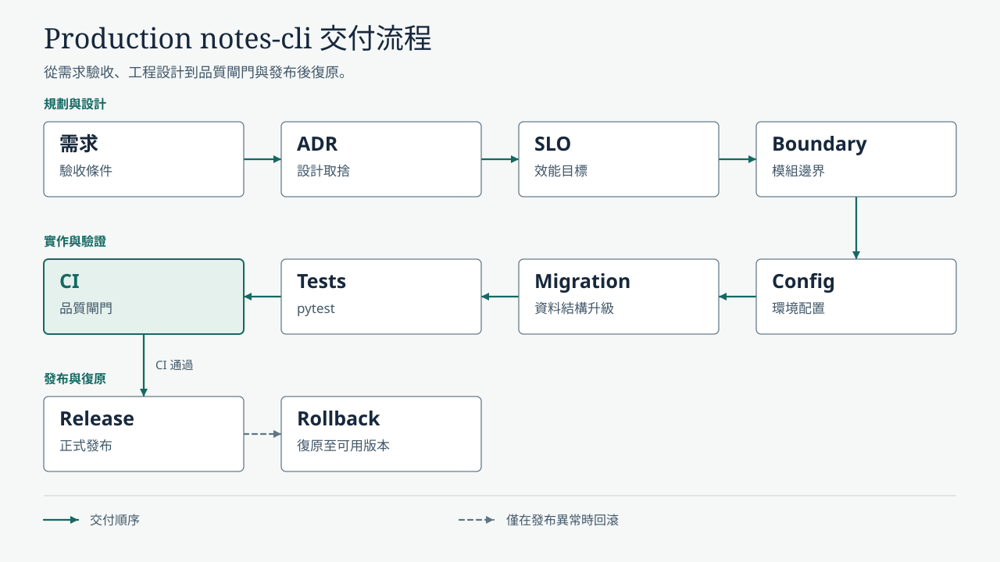
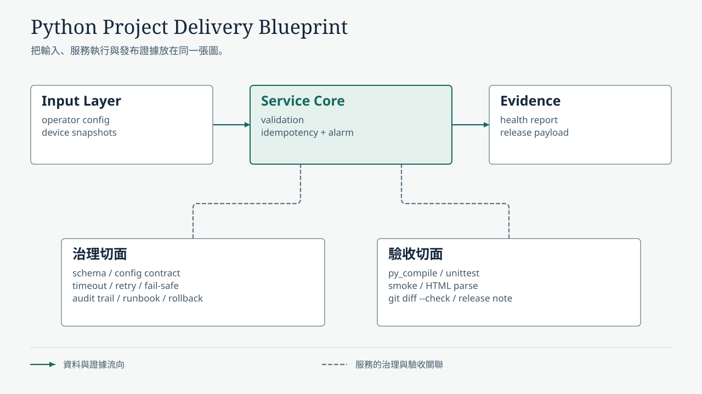

# Python 3.15 語法與新特性完整學習筆記

## 如何使用這份筆記

**核對版本：Python 3.15.2。資料核對日期：2026 年 11 月 24 日（台北時間）。** Python 3.15.0 已於 2026 年 10 月 9 日正式發布；本次官方下載與文件所列最新 3.15 維護版為 3.15.2，發布於 10 月 25 日。

這份筆記涵蓋 Python 核心語法、常用標準函式庫、3.15 新增與相容性變更、並行模式，以及工程實務範例。依需求可從頭學習，也可以直接查找對應章節。所有程式使用 Python 與標準函式庫，不需要 Node.js 或網頁建置工具；HTML 教材可直接開啟。

| 閱讀目的 | 先讀什麼 | 完成後應能做到 |
|---|---|---|
| 建立語法基礎 | 第一部：核心語法 | 寫出函式、類別、例外處理與資料轉換 |
| 已熟悉 Python，準備升級 | 第二部：3.15 新增與升級 | 判斷哪些新功能值得採用、哪些舊行為會改變 |
| 多台設備與多工作處理 | 第三部：並行與執行環境 | 正確選擇 asyncio、threads、processes、interpreters |
| 整合為可維護工具 | 第四部：實務與驗證 | 處理輸入品質、時間限制、JSON 報告及部署驗收 |
| 修正教材圖表 | 第五部：工程圖修正版 | 檢視已修正的箭頭、分支與文字內距 |

範例以溫度資料與設備監控為情境；文中的數值、測點與等待時間都是教學模擬。語法解說、官方規格與本次實測結果分開標示，不將範例結果當作現場設備或特定硬體效能。

官方依據：[Python 3.15.0](https://www.python.org/downloads/release/python-3150/)、[Python 3.15.2](https://www.python.org/downloads/release/python-3152/)、[完整語言參考](https://docs.python.org/3.15/reference/index.html)、[標準函式庫參考](https://docs.python.org/3.15/library/index.html)、[3.15 變更總覽](https://docs.python.org/3.15/whatsnew/3.15.html)。

## 執行環境與版本標籤

以下使用 `python3.15` 表示你實際安裝的 Python 3.15 執行檔。Windows 可使用可用的啟動器，例如 `py -3.15`；啟用虛擬環境後，統一使用 `python` 即可。

```bash
python3.15 --version
python3.15 -m venv .venv
# macOS / Linux
source .venv/bin/activate
# Windows PowerShell 使用 .venv\Scripts\Activate.ps1

python -m pip --version
python examples/core_syntax.py
python examples/new_features_315.py
python examples/concurrency_315.py
python examples/hvac_monitor_315.py --output report.json
```

只有要驗證 free-threaded 行為時，才另建一個對應的環境：

```bash
python3.15t -m venv .venv-ft
.venv-ft/bin/python examples/concurrency_315.py
```

不要讓一般版與 free-threaded 版共用同一個 `.venv`。名稱相同的 `python` 命令不一定指向相同的執行檔；透過 `sys.executable` 與 `sys.version` 確認。

| 標籤 | 本文件中的意思 |
|---|---|
| 核心語法／既有能力 | Python 3.15 可用，但不是宣稱 3.15 首次加入 |
| 3.15 新增 | 官方 3.15 文件或 PEP 確認本版新增 |
| CPython 實作 | 與直譯器實作、建置或平台有關，不是所有 Python 實作的保證 |
| 本次實測 | 使用隔離的 CPython 3.15.2 執行；完整紀錄附於資料包 |
| 工程建議 | 從語意與工作負載推導的設計選擇，需要對照實際需求 |

官方依據：[venv](https://docs.python.org/3.15/library/venv.html)、[Windows 啟動與安裝](https://docs.python.org/3.15/using/windows.html)、[macOS 的 free-threaded 安裝](https://docs.python.org/3.15/using/mac.html#installing-free-threaded-binaries)。


## 第一部｜核心語法與標準函式庫

### C01｜先讀懂程式的區塊與名稱

本篇整理 **Python 3.15 可以使用的核心語法**。多數功能早在先前版本就已存在；本篇不把 `match`、`dataclass`、`TaskGroup` 或泛型參數語法當成 3.15 新功能。閱讀順序可分成三段：先學資料與控制流程，再學函式與物件，最後學例外、型別、模組與非同步。

Python 以縮排界定區塊。`if`、`for`、`def`、`class` 等敘述的標頭以冒號結束，其內文增加一層縮排。工程專案通常每層使用四個空白；四個是風格慣例，真正的語法要求是區塊層級一致。不要混用 tab 與空白。括號內可自然換行，通常比行尾反斜線更易維護。

```python
supply_c = 7.2
return_c = 12.1

if return_c - supply_c >= 4.0:
    message = (
        "冰水溫差符合本次範例條件："
        f"{return_c - supply_c:.1f} °C"
    )
    print(message)
```

名稱區分大小寫；`pump_id` 與 `Pump_ID` 是不同名稱。名稱不能以數字開頭。Python 允許部分 Unicode 字元作為識別字，但混用形似字元會增加審查難度；設備代號與函式名稱宜維持一致的命名規範。`#` 開始行內註解；函式、類別或模組的第一個字串可成為 docstring，供 `help()` 與工具讀取。三引號字串本身不是一般註解語法。

`class`、`return`、`None` 等保留字不能拿來當一般變數。soft keyword 只在特定語境具有語法意義，例如 `match`、`case`、`_` 與 `type` 的相關用法；完整清單應直接查目前的直譯器，避免把不同版本的清單混用。內建名稱如 `list`、`str` 並非保留字，卻不宜被同名變數遮蔽。

```python
import keyword

print(keyword.iskeyword("class"))       # True
print(keyword.issoftkeyword("match"))   # True
print(keyword.kwlist)
print(keyword.softkwlist)
```

官方來源：[詞彙分析](https://docs.python.org/3.15/reference/lexical_analysis.html)、[keyword](https://docs.python.org/3.15/library/keyword.html)。

### C02｜數值、字串、f-string 與 bytes

`int` 適合計數、位址與位元遮罩；其大小受可用記憶體限制，沒有固定的 32 位元或 64 位元上限。`float` 適合一般連續量計算，但以二進位浮點表示，部分十進位小數無法精確保存。`complex` 可表示複數。`bool` 表示真假，雖然與整數有繼承關係，資料驗證仍應明確區分「數值讀值」與「開關狀態」。

```python
import math
from decimal import Decimal

raw_count = 12_500
register = 0x20
ratio = 3 / 2                 # 1.5
whole = -3 // 2               # -2，向負無限大取整
close = math.isclose(0.1 + 0.2, 0.3)
bill = Decimal("0.1") + Decimal("0.2")
```

`Decimal("0.1")` 從十進位文字建立精確的十進位值；若先寫成浮點數，再交給 `Decimal`，原先的近似值也會被帶入。浮點比較宜依問題設定相對與絕對容差，尤其在接近零的讀值附近。`round()` 與輸出格式化是不同操作：`f"{value:.1f}"` 只決定文字如何呈現，沒有修改原本讀值。

`str` 保存文字；單引號、雙引號在基本用途上等價。`\n`、`\t` 等跳脫序列用來表達特殊字元；raw string 如 `r"C:\logs\ahu"` 適合少寫反斜線，但不能以奇數個反斜線結尾。字串不可變，`replace()`、`strip()` 等通常回傳新字串。字串索引以 Unicode 碼點為基礎，畫面上一個可見字形不一定等於一個索引單位。

```python
point = "T10"
value = 24.375
label = f"{point}: {value:.1f} °C"   # T10: 24.4 °C
debug = f"{point=}, {value=}"       # 顯示名稱與值
literal = f"{{point}} = {point}"   # 雙大括號表示文字大括號

payload = "送風溫度".encode("utf-8")
text = payload.decode("utf-8")
frame = bytes([1, 3, 0, 32])
first_byte = frame[0]              # 1，索引結果是整數
```

`bytes` 是不可變的位元組序列，`bytearray` 則可修改。文字與位元組的轉換必須指定合適編碼；通訊封包的二進位欄位不是一般文字，不能一律 `decode()`。解讀多位元組整數時要另行確認 byte order、signed 與欄位長度，例如 `int.from_bytes(frame[2:4], "big")`。

官方來源：[數值與字串入門](https://docs.python.org/3.15/tutorial/introduction.html)、[輸出格式化](https://docs.python.org/3.15/tutorial/inputoutput.html)、[內建型別](https://docs.python.org/3.15/builtins/stdtypes.html)、[浮點限制](https://docs.python.org/3.15/tutorial/floatingpoint.html)、[decimal](https://docs.python.org/3.15/library/decimal.html)。

### C03｜名稱繫結、可變性與複製

`a = b` 把名稱 `a` 繫結到 `b` 所參照的物件，不代表複製資料。函式收到的引數同樣涉及物件參照：修改共用串列，呼叫端會看到；把函式內的參數改綁到另一個串列，則不會替呼叫端重新賦值。先分清楚「改物件」與「改名稱」，比背誦傳值或傳址更準確。

```python
from copy import deepcopy

original = {"AHU01": {"setpoint": 24.0}}
alias = original
shallow = original.copy()
deep = deepcopy(original)

original["AHU01"]["setpoint"] = 25.0
print(alias["AHU01"]["setpoint"])    # 25.0
print(shallow["AHU01"]["setpoint"])  # 25.0
print(deep["AHU01"]["setpoint"])     # 24.0
```

淺複製建立新的外層容器，但裡面的巢狀物件仍可共用。深複製會遞迴複製可複製的內容，代價與語意也不同；連線、檔案等外部資源不能當成一般資料隨意複製。建構設定快照時，應先決定哪些欄位要獨立，再選擇複製方式。

`list`、`dict`、`set` 一般可變；數字、`str`、`bytes`、`tuple` 一般不可變。但「tuple 不可變」只限制其元素參照，並不會把內部串列凍結：`([1],)` 裡的串列仍能 `append()`。`==` 比較值；`is` 比較是否同一物件。判斷缺值使用 `value is None`，不要依靠小整數或字串駐留的偶然結果。

另一個常見陷阱是 `rows = [[0] * 3] * 2`：兩列指向同一個內層串列。建立獨立二維資料應用 `[[0] * 3 for _ in range(2)]`。`del name` 解除名稱繫結，不代表所有引用該物件的名稱都消失，也不是外部資源即時關閉的保證。

官方來源：[物件資料模型](https://docs.python.org/3.15/reference/datamodel.html)、[淺複製與深複製](https://docs.python.org/3.15/library/copy.html)。

### C04｜運算子與優先序速查

運算子的行為與物件型別有關；例如 `+` 可以數值相加，也可以串接字串，`|` 可用於整數位元運算、集合聯集或字典合併。先確認操作對象，再解讀符號。

| 類別 | 語法 | 工程資料用途與提醒 |
|---|---|---|
| 算術 | `+ - * / // % **` | 加減乘除、整除、餘數與次方；`//` 不是一律朝零截斷 |
| 矩陣乘法 | `@` | 由支援此協定的型別提供；一般數字與串列不直接提供矩陣運算 |
| 比較 | `== != < <= > >=` | `0 <= valve <= 100` 是合法鏈式比較 |
| 邏輯 | `and or not` | 具有短路求值；`and`、`or` 可回傳運算元，不保證是 bool |
| 成員 | `in`、`not in` | `"T10" in readings` 對字典檢查的是鍵 |
| 身分 | `is`、`is not` | 比較同一物件；適合 `x is None` |
| 位元 | `& \| ^ ~ << >>` | 解析狀態字、旗標與遮罩 |
| 條件運算式 | `a if condition else b` | 選擇一個結果，兩個分支不會一起求值 |
| 賦值運算式 | `:=` | 在運算式中繫結名稱，需注意括號與可讀性 |
| 增強賦值 | `+= -= *=` 等 | 可能就地修改物件，不能一概當成建立新物件 |

常見優先序由高到低，可依下表查閱；同層大多由左向右結合，次方與條件運算式有不同結合規則。

| 由高到低 | 項目 |
|---|---|
| 1 | 括號分組、索引、切片、呼叫、屬性存取 |
| 2 | `await` |
| 3 | `**` |
| 4 | 一元 `+`、`-`、`~` |
| 5 | `* / // % @` |
| 6 | `+ -` |
| 7 | `<< >>` |
| 8 | `&`，接著 `^`，再接著 `\|` |
| 9 | 比較、`in`、`not in`、`is`、`is not` |
| 10 | `not`，接著 `and`，再接著 `or` |
| 11 | `a if condition else b` |
| 12 | `lambda` |
| 13 | `:=` |

`-2**2` 等於 `-(2**2)`，結果是 `-4`；`2**-2` 則允許右側負指數，結果為 `0.25`。複合位元條件建議寫成 `(status & 0b1000) != 0`，讓審查者直接看出遮罩範圍。`=` 是賦值敘述的語法，不是上述運算式優先序的一員。

```python
status = 0b1010
fan_proven = (status & 0b0010) != 0
has_alarm = (status & 0b1000) != 0
state = "異常" if has_alarm else "正常"

reading = 0.0
wrong_default = reading or 24.0          # 得到 24.0，吞掉有效零值
safe_default = 24.0 if reading is None else reading
```

官方來源：[運算式與優先序](https://docs.python.org/3.15/reference/expressions.html)、[布林運算與比較](https://docs.python.org/3.15/builtins/stdtypes.html)。

### C05｜容器、切片、解包與推導式

| 容器 | 典型資料 | 關鍵行為 |
|---|---|---|
| `list` | 按時間排列的溫度 | 有順序、可修改，可含重複值 |
| `tuple` | 一筆 `(point, value)` | 有順序、元素參照不可修改；單元素需逗號 `(7.2,)` |
| `dict` | 點位名稱對讀值 | 依鍵查找，保存插入順序；鍵需可雜湊 |
| `set` | 本輪離線設備集合 | 元素唯一；不應依賴迭代順序 |
| `frozenset` | 不變的點位集合 | 不可修改，可用於需要可雜湊集合的場合 |

空字典是 `{}`，空集合是 `set()`。字典缺鍵時 `d[key]` 會拋出 `KeyError`；`d.get(key)` 可回傳預設值，但要分辨「不存在」與「存在且值為 None」。修改方法如 `list.append()`、`list.sort()` 通常回傳 `None`；不要寫 `values = values.sort()`。

```python
values = [23.5, 24.0, 24.5, 25.0]
latest = values[-1]
recent = values[-2:]              # [24.5, 25.0]
alternate = values[::2]           # [23.5, 24.5]
reversed_values = values[::-1]
first, *middle, last = values

points = ["T10", "T11", "T12", "T13"]
readings = dict(zip(points, values, strict=True))
hot = {point: value for point, value in readings.items() if value >= 24.5}
rounded = [round(value, 1) for value in values]
unique_values = {value for value in values}
```

切片採 `start:stop:step`，`stop` 不包含在結果中。一般序列切片會容許超出邊界的範圍，但直接索引仍可能拋出 `IndexError`；步長不能是零。`a[:]` 對串列是淺複製，不會複製巢狀內容。解包時，星號目標會取得其餘項目形成的串列；沒有星號時，左右項目數必須符合。

`[*old, new]` 展開 iterable，`{**defaults, **overrides}` 合併 mapping，後面的同名鍵覆寫前面。函式呼叫的 `**kwargs` 則不容許把同一個參數值重複提供兩次。推導式適合清楚的轉換與篩選；兩三層巢狀且包含副作用時，改成一般迴圈比較容易除錯。`(x * 2 for x in values)` 是惰性產生器運算式，不會立刻建出完整串列。

官方來源：[資料結構](https://docs.python.org/3.15/tutorial/datastructures.html)、[zip 與內建函式](https://docs.python.org/3.15/builtins/functions.html)。

### C06｜if、match、迴圈與迴圈 else

`if` 由上而下檢查條件，只執行第一個成立分支。空容器、零、`None` 等通常視為假，但缺值與有效零值常有不同業務意義。監控資料最好先處理缺值，再比較上下限；對可能含 `NaN` 的浮點資料，還要明確決定無效值策略。

```python
def classify_temperature(value):
    if value is None:
        return "missing"
    elif value >= 28.0:
        return "high"
    else:
        return "normal"
```

`match` 是結構模式比對，能檢查字典、序列、常值與型別結構，不只是多分支 `if` 的縮寫。guard 是模式成功後的額外條件。一般裸名稱在模式裡通常是捕捉變數，不是讀取既有常數；常數比對可用字面值或帶限定名稱的屬性。`_` 表示不擷取該部分。

```python
def describe_event(event):
    match event:
        case {"kind": "temperature", "value": float(value)} if value >= 28:
            return f"高溫 {value:.1f} °C"
        case {"kind": "offline", "device": device}:
            return f"{device} 離線"
        case _:
            return "其他事件"
```

此處 `float(value)` 是類別模式，用來比對浮點物件並擷取其值，不會替字串執行 `float()` 轉型。字典模式預設允許額外鍵；若需求必須拒絕未知欄位，應另外驗證。模式也不會自動保證數值位於工程量程內。

`for` 逐項取得 iterable 的內容；`range(3)` 產生 `0、1、2`。需要索引時使用 `enumerate()`，平行走訪資料時使用 `zip()`，並在兩側長度應相同時考慮 `strict=True`。`while` 在每輪開始檢查條件；`break` 結束最近一層迴圈，`continue` 跳到下一輪，`pass` 則是不執行任何操作的佔位敘述。

```python
readings = {"T10": 24.0, "T11": 25.5}
for point, value in readings.items():
    if value > 28.0:
        print("第一個高溫點", point)
        break
else:
    print("本輪沒有找到高溫點")
```

迴圈的 `else` 在迴圈正常耗盡或條件變假時執行；`break` 會跳過它。它不是「最後一輪 if 沒成立」。如果用 `return` 或例外離開，也不會走到這個 `else`。走訪字典時增刪鍵容易出錯；可先建立待刪清單或新的篩選結果。

官方來源：[控制流程教學](https://docs.python.org/3.15/tutorial/controlflow.html)、[複合敘述與模式比對](https://docs.python.org/3.15/reference/compound_stmts.html)。

### C07｜函式參數：位置、關鍵字、可變引數

函式把輸入轉成輸出，讓讀值解析、單位換算與狀態判斷可以各自驗證。`return` 立即離開函式；沒有明確回傳值時結果是 `None`。`return value, quality` 是回傳一個 tuple，而不是建立兩條獨立輸出通道。函式定義也會建立物件，因此函式可被傳入、回傳或放進容器。

```python
def summarize(device, /, offset=0.0, *samples, unit="°C", **metadata):
    """回傳指定設備的平均讀值摘要。"""
    if not samples:
        raise ValueError("至少需要一筆讀值")
    mean = sum(samples) / len(samples) + offset
    return {"device": device, "mean": mean, "unit": unit, "metadata": metadata}

summary = summarize("AHU01", 0.2, 24.0, 26.0, unit="°C", floor=3)
```

| 參數位置 | 範例 | 呼叫規則 |
|---|---|---|
| `/` 前 | `device` | 只能以位置提供 |
| `/` 後、`*` 前 | `offset` | 可用位置或關鍵字 |
| `*samples` | 多筆讀值 | 接收其餘位置引數，形成 tuple |
| `*samples` 或裸 `*` 後 | `unit` | 只能以關鍵字提供 |
| `**metadata` | 額外欄位 | 接收其餘關鍵字引數，形成 dict |

如果不需要接收任意位置引數，可寫 `def convert(raw, /, *, scale=0.1): ...`。已經有 `*samples` 時，不再額外放裸 `*`。呼叫端的 `*values` 與 `**options` 是展開資料，定義端的星號則描述收集或限制參數，兩者要分開理解。

一般預設值在執行 `def` 建立函式時求值，不是每次呼叫重新建立。`def collect(value, history=[]): ...` 會讓多次呼叫共用同一串列。通常改成 `history=None`，進入函式後才建立新串列；若 `None` 本身也是合法且需區分的輸入，可自行建立唯一標記物件。

```python
def collect(value, history=None):
    if history is None:
        history = []
    history.append(value)
    return history

ranked = sorted([("T10", 25.0), ("T11", 23.0)], key=lambda item: item[1])
```

`lambda` 建立只有一個運算式的匿名函式，適合簡短排序鍵。包含多步驗證、重試或副作用的工作，應使用具名稱與 docstring 的 `def`。函式參數註記不會自動將字串轉為數字，也不會自動拒絕錯誤型別；檢查責任仍要明確安排。

官方來源：[函式與特殊參數](https://docs.python.org/3.15/tutorial/controlflow.html#special-parameters)、[函式定義](https://docs.python.org/3.15/reference/compound_stmts.html#function-definitions)。

### C08｜LEGB、閉包與裝飾器

一般函式名稱查找可先用 LEGB 理解：Local 是目前函式；Enclosing 是外層函式；Global 是所在模組；Builtins 是內建名稱。函式內只要存在對某名稱的賦值，通常就會把它視為區域名稱；在賦值前讀取，可能得到 `UnboundLocalError`。`if` 與一般 `for` 區塊不會像函式一樣另建區域作用域。

`global` 讓賦值作用於模組名稱，並不是宣告整個應用程式共同的全域變數。`nonlocal` 讓內層函式重新繫結最近外層函式的既有名稱。修改外層串列內容與重新繫結外層名稱不同；前者不一定需要 `nonlocal`。類別與型別參數另有作用域規則；方法內取得實例屬性應寫 `self.name`，不能把類別本體當成一般 enclosing function。

```python
def make_counter():
    count = 0
    def increment():
        nonlocal count
        count += 1
        return count
    return increment

counter = make_counter()
print(counter(), counter())   # 1 2
```

閉包保存對外層名稱的存取，並非自動保存建立瞬間的數值。迴圈中建立多個 `lambda: i`，之後呼叫時通常讀到同一個最後值。需要固定當時資料，可使用工廠函式，或像 `lambda i=i: i` 這樣把當時值放進預設參數。讀取閉包狀態時也要考量它是否被其他呼叫修改。

裝飾器接收一個函式或類別，再回傳替代物件。`@audit` 放在函式上方，大致相當於定義後執行 `fn = audit(fn)`；多層裝飾器從貼近函式的一層開始套用。使用 `functools.wraps` 保存名稱、docstring 等資訊，有助於追查與產生說明。

```python
from functools import wraps

def audit(fn):
    @wraps(fn)
    def wrapper(*args, **kwargs):
        result = fn(*args, **kwargs)
        return {"operation": fn.__name__, "result": result}
    return wrapper

@audit
def normalize(raw):
    return raw / 10.0

print(normalize(245))  # {'operation': 'normalize', 'result': 24.5}
```

這個裝飾器刻意改變回傳格式，呼叫端必須知道新的契約。工程程式使用裝飾器時，應檢查它是否改變例外、回傳型別與呼叫時機，不能只看被包覆的函式本體。

官方來源：[執行與名稱解析模型](https://docs.python.org/3.15/reference/executionmodel.html)、[functools.wraps](https://docs.python.org/3.15/library/functools.html#functools.wraps)。

### C09｜class、dataclass 與物件協定

類別把狀態與操作放在同一個物件裡。`self` 是慣用的實例參數名稱；呼叫 `obj.method()` 時，物件會成為方法的第一個引數。`__init__()` 負責初始化已建立的實例，不能回傳另一個物件。類別屬性由實例共享；每個設備各自的讀值串列通常應在 `__init__()` 建立。

```python
from dataclasses import dataclass, field

@dataclass
class DeviceSnapshot:
    device: str
    temperature_c: float
    alarms: list[str] = field(default_factory=list)

    @property
    def temperature_f(self):
        return self.temperature_c * 9 / 5 + 32

    @classmethod
    def from_raw(cls, device, raw):
        return cls(device, raw / 10.0)

    @staticmethod
    def valid_name(name):
        return bool(name) and name.isascii()
```

`dataclass` 可依欄位產生初始化、表示與相等比較等方法；`default_factory=list` 讓每個實例有自己的串列。`frozen=True` 阻止一般欄位重新賦值，但不會遞迴凍結欄位裡的串列。它也不是輸入驗證器：註記 `float` 不會自動拒絕字串。`property` 讓計算或受控存取具有屬性外觀；唯讀 property 沒有 setter，但其他可變欄位仍可被改動。

`classmethod` 接收類別 `cls`，適合替代建構入口，繼承時也能建立子類別實例。`staticmethod` 不接收隱含 `self` 或 `cls`，適合與類別概念相關但不依賴實例狀態的小工具。若工具與類別關係不強，直接用模組函式通常更容易發現。

```python
class Sensor:
    def __init__(self, name):
        self.name = name

class CalibratedSensor(Sensor):
    def __init__(self, name, offset):
        super().__init__(name)
        self.offset = offset
```

`super()` 沿著方法解析順序呼叫下一個實作，在多重繼承裡不等於固定指定某個父類別。多重繼承若要合作，方法簽章與 `super()` 呼叫方式必須配合。一般組合關係，如「監控服務有一個感測器」，常可先用物件持有另一物件表達，不必急著使用繼承。

| 特殊方法 | 對應操作 | 設計用途 |
|---|---|---|
| `__repr__` | `repr(obj)` | 提供可辨識的診斷表示 |
| `__str__` | `str(obj)` | 面向讀者的文字 |
| `__len__` | `len(obj)` | 容器長度 |
| `__iter__`、`__next__` | `for`、`next()` | 可迭代與迭代器協定 |
| `__getitem__` | `obj[key]` | 索引或鍵存取 |
| `__eq__`、`__hash__` | 相等與雜湊 | 設計鍵物件時須維持一致性 |
| `__enter__`、`__exit__` | `with` | 資源取得與釋放 |
| `__call__` | `obj(...)` | 讓實例成為可呼叫物件 |

這些方法構成物件協定，讓自訂型別融入 Python 語法；不要只因為可以就替設備物件塞入所有運算子。可變物件若用作字典鍵，還要避免相等或雜湊依據在存放期間改變。

官方來源：[類別教學](https://docs.python.org/3.15/tutorial/classes.html)、[dataclasses](https://docs.python.org/3.15/library/dataclasses.html)、[特殊方法](https://docs.python.org/3.15/reference/datamodel.html)、[property、classmethod、staticmethod、super](https://docs.python.org/3.15/builtins/functions.html)。

### C10｜迭代器、yield 與 yield from

iterable 是能提供迭代器的物件；iterator 是保存目前進度、能被 `next()` 推進的物件。`iter(values)` 取得迭代器，耗盡後會拋出 `StopIteration`。串列可反覆建立新的迭代器，而同一個產生器通常只能走訪一次；把它傳給 `sum()` 後，後續再走訪可能已沒有資料。

```python
def valid_values(rows):
    for row in rows:
        value = row.get("value")
        if value is not None:
            yield float(value)

rows = [{"value": "24.1"}, {"value": None}, {"value": "25.3"}]
stream = valid_values(rows)
print(next(stream))       # 24.1
print(list(stream))       # [25.3]
print(list(stream))       # []
```

函式包含 `yield` 時，呼叫它會取得產生器；函式本體等到迭代時才前進。每次 `yield` 暫停並保留區域狀態，適合逐筆解析趨勢檔。這不表示每筆資料一定即時從硬體讀取，實際資料來源仍由函式內容決定。產生器也可能在消費到特定資料時才拋出轉型例外。

`yield from iterable` 把迭代工作委派給另一個 iterable。它除了逐項轉交值，也支援產生器間的 `send()`、`throw()`、關閉與回傳值傳遞；基礎資料串流先掌握逐項委派即可。

```python
def merge_batches(batches):
    for batch in batches:
        yield from batch

print(list(merge_batches([[24.0, 25.0], [26.0]])))
```

惰性處理可減少中間容器，但不是所有來源都會自動節省記憶體：如果讀檔前已把整個檔案放進串列，後段再包成產生器，前段配置仍然存在。`itertools.islice()`、`chain()`、`pairwise()` 可支援分段、串接與相鄰差值；需要排序的步驟則通常必須先蒐集相應資料。

官方來源：[迭代器與產生器](https://docs.python.org/3.15/tutorial/classes.html#iterators)、[yield 運算式](https://docs.python.org/3.15/reference/expressions.html#yield-expressions)、[itertools](https://docs.python.org/3.15/library/itertools.html)。

### C11｜例外、原因鏈與 ExceptionGroup

例外讓正常結果與失敗路徑分開。`try` 只包住預期可能失敗、且此處知道如何處理的操作；捕捉太大一段程式，容易把程式錯誤誤認為輸入問題。多個 `except` 由上而下尋找相符類別，具體例外通常放在一般例外之前。沒有合適處理者時，例外會沿呼叫鏈往外傳。

```python
class InvalidReading(ValueError):
    pass

def parse_temperature(raw):
    try:
        value = float(raw)
    except (TypeError, ValueError) as exc:
        raise InvalidReading(f"無法解析溫度：{raw!r}") from exc
    else:
        return value
    finally:
        pass  # 若此函式取得資源，必要清理應明確放在這裡
```

`else` 放在 `try` 正常完成時才執行的工作；這裡發生的例外不會被前面的 `except` 再捕捉。`finally` 在正常或例外離開時執行，適合必要清理；不要在其中用 `return` 蓋掉原本的回傳或例外。突然終止行程、斷電等情況也不屬於語言清理保證。

`raise` 可重新拋出正在處理的例外，`raise NewError(...) from exc` 明確保留根本原因。`from None` 只抑制顯示中的原因鏈，不會修復錯誤。`except Exception` 不包含所有 `BaseException` 子類別；中斷、退出與取消有自己的控制意義，不宜無差別吞掉。`assert` 適合開發時檢查不變量，但可能因最佳化選項被移除，不能取代外部輸入驗證。

```python
failures = [ValueError("T10 格式錯誤"), TimeoutError("AHU02 逾時")]
try:
    raise ExceptionGroup("本輪採樣失敗", failures)
except* ValueError as group:
    print("資料格式失敗數", len(group.exceptions))
except* TimeoutError as group:
    print("逾時數", len(group.exceptions))
```

`ExceptionGroup` 表達多個失敗，`except*` 會依其中的例外分組處理，因此同一次處理可執行不只一個分支。未處理的部分仍往外傳。同一個 `try` 不能混放 `except` 與 `except*`；也不能在 `except*` 區塊中使用 `return`、`break` 或 `continue`。群組可以巢狀，`len(group.exceptions)` 只計算直接子項，不能一律當作全部葉節點失敗數。

官方來源：[例外教學](https://docs.python.org/3.15/tutorial/errors.html)、[例外類別與原因鏈](https://docs.python.org/3.15/builtins/exceptions.html)、[except* 規則](https://docs.python.org/3.15/reference/compound_stmts.html#except-star)。

### C12｜with 與 contextmanager：把生命週期寫進結構

`with` 用來描述進入與離開某個資源範圍。檔案、鎖與某些連線物件支援這個協定。進入時呼叫 `__enter__()`；成功進入後離開區塊時呼叫 `__exit__()`，並把例外資訊交給它。`__exit__()` 回傳真值可抑制例外，因此閱讀自訂 context manager 時要確認它是否吞掉失敗。

```python
from contextlib import contextmanager
from pathlib import Path
from tempfile import TemporaryDirectory

@contextmanager
def temporary_output(directory):
    with TemporaryDirectory(dir=directory) as owned_dir:
        yield Path(owned_dir) / "snapshot.tmp"
```

`TemporaryDirectory` 先建立本次工作專用的目錄，離開時只清理該目錄裡的資源。清理責任應跟著資源的建立與擁有關係安排。

用 `@contextmanager` 包裝的產生器應恰好 `yield` 一次。`yield` 前準備資源，交出的值成為 `as` 後的名稱，離開區塊後繼續執行清理。若區塊內拋出例外，例外會在產生器的 `yield` 位置重新出現；只想記錄而不想吞掉時，處理後須再 `raise`。

把資源生命週期放進 `with`，呼叫端較不容易漏掉關閉。多個 context manager 可放在同一個 `with`，退出順序與進入相反。進入第二個資源失敗時，已成功進入的第一個仍能退出。需要動態數量的資源時，可查 `contextlib.ExitStack`；不必手工堆疊多層 `try/finally`。

官方來源：[contextlib](https://docs.python.org/3.15/library/contextlib.html)、[with 敘述](https://docs.python.org/3.15/reference/compound_stmts.html#the-with-statement)。

### C13｜typing：說清楚資料契約

型別註記服務於閱讀、編輯器與靜態檢查工具；Python 不會僅因有註記，就在執行時強制驗證資料。`list[float]` 描述元素型別，`float | None` 表示可能缺值。允許 `None` 與「呼叫時可以省略參數」是兩件事，後者仍需要預設值。

```python
from collections.abc import Sequence
from typing import Protocol, TypedDict

type PointMap = dict[str, float]

def first[T](items: Sequence[T]) -> T:
    if not items:
        raise ValueError("序列不可為空")
    return items[0]

class SampleBox[T]:
    def __init__(self, value: T):
        self.value = value

class Reader(Protocol):
    def read(self, point: str) -> float: ...

class Reading(TypedDict):
    point: str
    value: float
    quality: str
```

`type PointMap = ...` 是型別別名；`T` 讓輸入與輸出的型別關係得以保留，例如 `first()` 回傳輸入序列的元素型別。泛型是描述關係，不代表 Python 會自動產生每種型別的特化機器碼。別名也不等於新增一種執行時數值型別，不能直接把型別別名當作 `isinstance()` 的一般類別參數。

`Protocol` 描述「提供哪些成員就能合作」，適合把監控邏輯與不同通訊實作分開；符合介面的類別不必明確繼承它。`TypedDict` 則描述字典欄位，執行時仍是普通 dict，不會自動檢查缺鍵、額外鍵或型別。需要驗證外部 JSON 時，仍須撰寫解析與檢查。

`Any` 讓檢查器容許動態操作，會減少型別保證；`object` 表示型別未知，但使用前須先確認支援的操作。接收未知外部輸入時，用 `object` 配合 `isinstance()` 縮小型別，通常比較能保留檢查價值。`isinstance(value, (int, float))` 也會接受 bool；若業務規則不接受布林數字，應明確排除。

官方來源：[typing](https://docs.python.org/3.15/library/typing.html)、[泛型與型別參數](https://docs.python.org/3.15/reference/compound_stmts.html#type-parameter-lists)。

### C14｜模組、import、入口與環境管理

一個 `.py` 檔通常就是一個模組；模組讓程式依責任分工，例如解析、計算、報表與入口。`import math` 將模組名稱帶入目前作用域，`from math import isclose` 則帶入指定名稱。一般匯入會執行模組頂層敘述並利用模組快取；頂層因此宜放定義與必要初始化，不要在被匯入時意外啟動長期採集工作。

```python
# 假設此檔名為 report_cli.py

def main() -> int:
    print("產生監控摘要")
    return 0

if __name__ == "__main__":
    raise SystemExit(main())
```

直接執行檔案時，入口模組名稱是 `__main__`。`python -m package.module` 以模組方式啟動，通常更適合套件內的相對匯入。不要把自己的檔案命名為 `json.py`、`typing.py` 等常用標準庫名稱，以免搜尋路徑優先找到自己的檔案。`from module import *` 會讓來源不清楚，維護時通常使用明確匯入。

```bash
python3.15 -m venv .venv
# macOS / Linux
.venv/bin/python -m pip --version
.venv/bin/python report_cli.py
# Windows 對應直譯器：.venv\Scripts\python.exe
```

虛擬環境隔離專案套件，不是容器或權限隔離機制。它通常應在目標系統依依賴宣告重新建立，而非直接搬移整個目錄。使用 `python -m pip` 能讓安裝工具與目前選定的直譯器一致；啟用環境是方便的 PATH 調整，直接使用環境內的 Python 路徑也能工作。

`pyproject.toml` 放專案與工具設定：`[build-system]` 描述建置後端及建置依賴，`[project]` 放名稱、版本、支援的 Python 範圍與執行依賴，`[tool.*]` 放個別工具選項。它不是 Python 執行語法，也不會單憑檔案存在就安裝依賴或鎖定所有間接版本。鎖檔、套件來源與部署重現性應由專案工具流程另外安排。

官方來源：[模組教學](https://docs.python.org/3.15/tutorial/modules.html)、[venv](https://docs.python.org/3.15/library/venv.html)、[PyPA：pyproject.toml](https://packaging.python.org/en/latest/guides/writing-pyproject-toml/)。

### C15｜檔案、JSON 與標準庫選用

文字檔使用 `str`，二進位檔使用 `bytes`。`"r"` 讀取、`"w"` 寫入並截斷既有檔案、`"a"` 附加；加上 `"b"` 表示二進位模式。明確寫出文字編碼與預期檔案路徑，能讓資料交換意圖更清楚。`Path` 適合組合路徑與基本檔案操作，避免手工拼接不同作業系統的分隔符。

```python
import json
from pathlib import Path
from tempfile import TemporaryDirectory

snapshot = {"device": "AHU01", "temperature_c": 24.5, "online": True}
with TemporaryDirectory() as directory:
    path = Path(directory) / "snapshot.json"
    with path.open("w", encoding="utf-8") as file:
        json.dump(snapshot, file, ensure_ascii=False, indent=2, allow_nan=False)
    with path.open("r", encoding="utf-8") as file:
        restored = json.load(file)
    print(restored["temperature_c"])
```

`dump/load` 使用檔案物件，`dumps/loads` 使用字串資料。`ensure_ascii=False` 讓中文直接呈現；`allow_nan=False` 可拒絕非有限浮點值的非標準 JSON 表示。JSON 物件的鍵是字串，tuple 通常轉成 array，`datetime`、自訂類別與二進位封包也不會自動保留原型別。成功解析 JSON 只代表格式可讀，欄位、型別、單位與量程仍應另外檢查。

| 工作 | 可先查看的標準庫 | 使用方向 |
|---|---|---|
| 路徑與暫存 | `pathlib`、`tempfile` | 路徑操作、測試與暫存資源 |
| 結構化檔案 | `json`、`csv`、`tomllib` | 交換資料、表格、讀取 TOML 設定 |
| 日期與時區 | `datetime`、`zoneinfo` | 記錄帶時區的採樣時間 |
| 時間間隔 | `time` | `monotonic()` 計算逾時，`perf_counter()` 量測耗時 |
| 數值分析 | `math`、`statistics`、`decimal` | 有限值判斷、統計與十進位計算 |
| 容器與串流 | `collections`、`itertools` | 計數、佇列資料、惰性轉換 |
| CLI 與診斷 | `argparse`、`logging` | 參數解析與分級紀錄 |
| 品質檢查 | `unittest`、`doctest` | 行為測試與簡短互動例子驗證 |
| 外部行程 | `subprocess` | 以參數陣列執行工具並檢查結果 |

測量兩個事件的間隔，宜使用單調時鐘；要記錄「何時發生」，則需要可解讀的日期時間。兩者用途不同。工程資料處理可先用標準庫建立清楚的邊界，再評估專門套件是否值得增加安裝與維護成本。

官方來源：[JSON](https://docs.python.org/3.15/library/json.html)、[pathlib](https://docs.python.org/3.15/library/pathlib.html)、[標準庫導覽](https://docs.python.org/3.15/tutorial/stdlib.html)、[標準庫索引](https://docs.python.org/3.15/library/index.html)、[time](https://docs.python.org/3.15/library/time.html)。

### C16｜async 語法與 TaskGroup 的基本使用

不含 `yield` 的 `async def` 定義 coroutine function，呼叫後取得 coroutine object；通常還要 `await`、交給 task，或由 `asyncio.run()` 啟動，工作才會執行。`await` 等待 awaitable 的完成，適合可配合事件迴圈的非同步操作；它不是把一般阻塞函式自動改成非同步的符號。

```python
import asyncio

async def read_simulated(point: str) -> tuple[str, float]:
    await asyncio.sleep(0)
    return point, 24.5

async def collect() -> dict[str, float]:
    async with asyncio.TaskGroup() as group:
        tasks = [
            group.create_task(read_simulated(point))
            for point in ("T10", "T11", "T12")
        ]
    return dict(task.result() for task in tasks)

# 在一般 Python 腳本入口執行：
# print(asyncio.run(collect()))
```

`TaskGroup` 用結構化範圍管理多個 task：離開 `async with` 前會等候群組內工作完成。一般 task 失敗時會取消其他尚未完成的 task，收集相應失敗後向外提出例外群組；中斷與退出等例外另有特定處理規則。呼叫端應決定哪些失敗可以恢復，不能只把所有例外轉成空結果。

`async for` 用於非同步迭代器，每次取得下一筆時可以等待；含有 `yield` 的 `async def` 則建立非同步產生器。`async with` 用於其進入或離開本身需要等待的 context manager，對應 `__aenter__()` 與 `__aexit__()`。

```python
async def simulated_stream():
    for value in (24.0, 24.5, 25.0):
        await asyncio.sleep(0)
        yield value

async def summarize_stream():
    values = []
    async for value in simulated_stream():
        values.append(value)
    return sum(values) / len(values)
```

一般腳本可在入口使用一次 `asyncio.run(main())`；已經有運行中事件迴圈的環境，應配合該環境的頂層 `await` 或整合方式，不能在同一執行緒任意巢狀呼叫 `asyncio.run()`。取消通常會在可等待位置交付，清理可放在 `finally`，不宜無意吞掉取消訊號。非同步語法負責等待與協作，是否採用多核心、執行緒或行程，屬於另一層架構決策。

官方來源：[coroutine 與 TaskGroup](https://docs.python.org/3.15/library/asyncio-task.html)、[非同步敘述](https://docs.python.org/3.15/reference/compound_stmts.html#coroutines)、[非同步產生器](https://docs.python.org/3.15/reference/expressions.html#asynchronous-generator-functions)。

## 第二部｜Python 3.15 新增與升級變更

### Python 3.15 新特性與升級指南

查證日期：2026-11-24（UTC）。以下依 Python 3.15.2 官方文件整理；隨附 `examples/new_features_315.py` 已在 Linux x86-64 的 CPython 3.15.2 實際執行，16 組範例通過。型別檢查器的靜態診斷與其他作業系統行為不包含在這項實測中。

### 版本狀態

Python 3.15.0 的官方發布日期為 2026-10-09；截至本次查證，官方 3.15 文件標題是 3.15.2，版本列表將 3.15.2 列為 2026-10-25 發布。請以 3.15.2 作為教材核對版本，而非 alpha/beta。

來源：[3.15.0 發布頁](https://www.python.org/downloads/release/python-3150/)、[3.15.2 發布頁](https://www.python.org/downloads/release/python-3152/)、[官方版本列表](https://www.python.org/doc/versions/)。

### 真正屬於 3.15 的主要變更

| 分類 | 3.15 新增或改變 | 來源 |
|---|---|---|
| 語法 | `lazy import`、`lazy from … import …` | PEP 810 |
| 語法 | 推導式及產生器運算式使用 `*` / `**` 解包 | PEP 798 |
| 內建型別 | `frozendict` 淺不可變映射 | PEP 814 |
| 內建型別 | `sentinel()` 唯一標記值 | PEP 661 |
| 編碼 | UTF-8 mode 預設開啟 | PEP 686 |
| 型別註記 | TypedDict 的 `closed` / `extra_items` | PEP 728 |
| 型別註記 | `typing.TypeForm` | PEP 747 |
| 型別註記 | `typing.disjoint_base` | PEP 800 |
| 整數數學 | `math.integer` 子模組 | PEP 791 |
| 啟動配置 | `.start` 套件啟動進入點 | PEP 829 |
| 效能工具 | `profiling.tracing` / `profiling.sampling`（Tachyon） | PEP 799 |
| 執行環境 | free-threaded Stable ABI 等 | PEP 803、820、793；並行章另述 |
| 底層觀測 | frame pointers 預設啟用 | PEP 831 |

上述語法、內建型別、編碼、型別註記與整數數學 PEP 在查證時皆顯示 Final、Python-Version 3.15。CPython 的實作與 API 細節，以相應版本的官方文件及實測結果為準。

### 1. lazy import：把載入推遲到第一次使用

```python
# Python 3.15+；放在模組頂層。
lazy import json
lazy from pathlib import Path


def load_device_config(path: str) -> dict:
    return json.loads(Path(path).read_text(encoding="utf-8"))


print("命令列已啟動；尚未使用設定讀取功能")
```

`lazy` 是 soft keyword。宣告後建立延遲代理，名稱第一次實際使用時完成模組匯入。載入失敗也延到首次使用時出現；匯入時的註冊、環境設定等副作用同樣延後。只允許模組層級；函式、類別及 try/except/finally 內不允許，`*` 匯入與 `__future__` 匯入也不能延遲。

跨舊版原始碼可用 `__lazy_modules__ = ["json", "pathlib"]` 搭配普通 import；3.15 會據此延遲，舊版不使用這個特別協定。`-X lazy_imports=all` / `PYTHON_LAZY_IMPORTS=all` 是廣泛啟用選項，預設 `normal` 尊重原始碼宣告。

工程建議（推論）：CLI 中不一定用到的匯出或報表模組適合評估延遲；連線驅動、授權檢查與必須開機即失敗的初始化不應只為縮短啟動秒數而延後。

來源：[PEP 810](https://peps.python.org/pep-0810/)。

### 2. 推導式解包：一次展開一層

```python
batches = [(23.4, 24.1), (25.2,), ()]
values = [*batch for batch in batches]
unique = {*batch for batch in batches}
stream = (*batch for batch in batches)

parts = [{"AHU01": 23.4}, {"AHU02": 25.2}, {"AHU01": 23.8}]
latest = {**part for part in parts}

assert values == [23.4, 24.1, 25.2]
assert list(stream) == values
assert latest == {"AHU01": 23.8, "AHU02": 25.2}
```

此機制只攤平一層，並非遞迴展平。字典重複鍵由後出現的值覆蓋。既有 `[*a, *b]`、`{**a, **b}` 在舊版就有，3.15 新增的是解包進入推導式／產生器運算式。

來源：[PEP 798](https://peps.python.org/pep-0798/)。

### 3. frozendict：設定快照與不可變映射

```python
config = frozendict(device="AHU01", timeout=1.5)
assert config["timeout"] == 1.5
assert not isinstance(config, dict)
lookup = {config: "已驗證"}  # 本例的鍵與值皆可雜湊。

# config["timeout"] = 2.0  # TypeError
nested = frozendict(samples=[])
nested["samples"].append(24.5)  # 內層 list 仍可修改。
```

凍結的是映射結構，並不遞迴凍結值。所有鍵和值都可雜湊時，整個 frozendict 才可雜湊。它不是 dict 子類，可用 `collections.abc.Mapping` 接收一般映射。維持插入順序，但相等比較不以順序為準；沒有新的 frozendict literal 語法。

來源：[PEP 814](https://peps.python.org/pep-0814/)、[內建型別](https://docs.python.org/3.15/builtins/stdtypes.html#frozendict)。

### 4. sentinel：區分沒傳入與有意傳入 None

```python
MISSING = sentinel("MISSING")


def describe_setting(value: float | None | MISSING = MISSING) -> str:
    if value is MISSING:
        return "沿用原設定"
    if value is None:
        return "清除此設定"
    return f"更新設定為 {value}"


assert describe_setting() == "沿用原設定"
assert describe_setting(None) == "清除此設定"
```

每次呼叫 `sentinel()` 產生不同物件，應建立一次並重用，用 `is` 判斷。複製會保留 identity；只有能依模組及名稱找回的 sentinel 才能 pickle 並保留 identity。它在布林判斷中為真，不能用 `if value:` 判斷缺省。目前實作另有 `repr=` 關鍵字參數；若與 PEP 舊措辭不一致，以 API 文件為準。

來源：[PEP 661](https://peps.python.org/pep-0661/)、[sentinel API](https://docs.python.org/3.15/builtins/functions.html#sentinel)。

### 5. UTF-8 預設

3.15 預設開啟 UTF-8 mode；沒有指定 encoding 的文字檔案、標準串流與 pipe 行為因此可能改變。既有 Big5、CP950 或其他舊系統檔案不能靠升級自動辨識，應明確指定真正編碼。

```python
from pathlib import Path
text = Path("settings.txt").read_text(encoding="utf-8")
legacy = Path("legacy.csv").read_text(encoding="cp950")
```

`encoding="locale"` 可明確指定環境地區編碼；`PYTHONUTF8=0` 或 `-X utf8=0` 可停用 UTF-8 mode。`python -X warn_default_encoding ...` 能協助找出隱含預設編碼使用點。

來源：[PEP 686](https://peps.python.org/pep-0686/)。

### 6. 型別註記：資料邊界更精確

#### TypedDict 的 closed 與 extra_items

```python
from typing import TypedDict

class DeviceConfig(TypedDict, closed=True):
    name: str
    timeout: float

class Measurements(TypedDict, extra_items=float):
    device: str

ok: Measurements = {"device": "AHU01", "temperature": 24.5}
```

`closed=True` 不允許額外鍵；`extra_items=float` 規範未宣告鍵的值型別。兩者不能在同一 TypedDict 定義中同時使用。這是靜態型別協定，執行期仍為一般 dict，不會自動驗證 JSON。

來源：[PEP 728](https://peps.python.org/pep-0728/)。

#### TypeForm

```python
from typing import TypeForm

schema: TypeForm[dict[str, float]] = dict[str, float]
assert TypeForm(schema) is schema
```

`TypeForm[T]` 描述代表 T 或其可指派型別的「型別運算式值」，可涵蓋聯集、泛型別名等，範圍比只接受類別物件的 `type[T]` 廣。`TypeForm(x)` 在執行期直接傳回 x，不是資料驗證器或轉型函式。

來源：[PEP 747](https://peps.python.org/pep-0747/)、[typing.TypeForm](https://docs.python.org/3.15/library/typing.html#typing.TypeForm)。

#### disjoint_base

`@typing.disjoint_base` 告訴型別檢查器：不具祖先／子孫關係的兩個 disjoint base 不應被同一類別共同繼承。用於診斷不可能交集或不可達分支；裝飾器本身不等同執行期禁止多重繼承。

來源：[PEP 800](https://peps.python.org/pep-0800/)。

### 7. profiling / Tachyon

新增 `profiling.tracing` 整理原 cProfile 功能，`cProfile` 保留相容別名；純 Python 的 `profile` 模組被棄用，預計 3.17 移除。`profiling.sampling` 是新的統計取樣工具，可啟動腳本、執行模組或附加既有 PID，也能輸出獨立 HTML flame graph。

```bash
python3.15 -m profiling.sampling run worker.py
python3.15 -m profiling.sampling run --flamegraph -o profile.html worker.py
python3.15 -m profiling.sampling attach 12345
python3.15 -m profiling.sampling dump 12345
```

預設取樣率為 1 kHz，並非所有工作負載自動得到 1 MHz。取樣器本身的 CPU 用量、附加權限、平台差異及資料完整性仍須評估；若使用 blocking 模式，取樣會暫停目標。

來源：[profiling](https://docs.python.org/3.15/library/profiling.html)、[sampling](https://docs.python.org/3.15/library/profiling.sampling.html)。

### 8. 新增實用標準函式庫 API

#### math.integer：集中整數數學函式

```python
from math.integer import comb, factorial, gcd, isqrt, lcm, perm

assert comb(8, 3) == 56
assert factorial(6) == 720
assert gcd(48, 18) == 6
assert isqrt(99) == 9
assert lcm(6, 8) == 24
assert perm(5, 2) == 20
```

這個新子模組集中 `comb`、`factorial`、`gcd`、`isqrt`、`lcm`、`perm` 六個整數運算函式，接受整數或實作 `__index__()` 的物件，結果以整數精確計算。原本 `math` 中的對應入口保留；新增的是清楚的整數運算命名空間，不能把組合數、最大公因數等算法說成3.15才有。

來源：[PEP 791](https://peps.python.org/pep-0791/)、[math.integer](https://docs.python.org/3.15/library/math.integer.html)。

#### JSON 可生成遞迴不可變結構

```python
import json
snapshot = json.loads(
    '{"device":"AHU01","values":[24.5,24.8]}',
    object_pairs_hook=frozendict,
    array_hook=tuple,
)
assert snapshot["values"] == (24.5, 24.8)
```

`array_hook` 會作用在每一個 JSON array 的解碼結果，與 object_pairs_hook 的 frozendict 搭配可讓一般 JSON 結構的容器皆不可變。

來源：[json](https://docs.python.org/3.15/library/json.html)。

#### bytearray.take_bytes

```python
buffer = bytearray(b"OK\nNEXT")
line = buffer.take_bytes(3)
assert line == b"OK\n"
assert buffer == bytearray(b"NEXT")
rest = buffer.take_bytes()
assert rest == b"NEXT" and not buffer
```

取出部分時會留下剩餘內容並涉及複製；取出全部且清空的 CPython 路徑可零複製。這是 CPython 實作細節，不能宣稱所有 Python 實作一律零複製。

來源：[bytearray.take_bytes](https://docs.python.org/3.15/builtins/stdtypes.html#bytearray.take_bytes)。

#### 其他實用 API

- `re.prefixmatch()`：明確表示只在開頭比對；`re.match()` 僅 soft deprecated，無移除計畫；既有舊版相容碼可繼續用 match。[re](https://docs.python.org/3.15/library/re.html)
- `math.fmax/fmin`：以「NaN 視作缺失」規則比較浮點；`isnormal/issubnormal/signbit` 補足浮點分類和符號檢查。[math](https://docs.python.org/3.15/library/math.html)
- `base64` 家族擴充 padded、wrapcol、ignorechars、canonical 等參數；不是每個函式都具備全部參數。[base64](https://docs.python.org/3.15/library/base64.html)
- `Path.mkdir(parent_mode=...)` 與 `os.makedirs(parent_mode=...)`：可設定中間目錄 mode。[pathlib](https://docs.python.org/3.15/library/pathlib.html)
- `ssl` 新增 TLS 1.3 cipher suites、key agreement groups 與 signature algorithms 管理 API；部分依賴較新的 OpenSSL 版本，不能只看 Python 版本判斷可用性。[ssl](https://docs.python.org/3.15/library/ssl.html)
- `threading.serialize_iterator`、`synchronized_iterator`、`concurrent_tee`；`sys.abi_info`：並行章另述。

#### Unicode 字素分段與 TOML 1.1

`unicodedata` 更新至 Unicode 17.0.0，新增識別字判斷及字素分段。`iter_graphemes()` 產生的是 `Segment` 物件；用 `str(segment)` 取得文字，`start` / `end` 是原始字串位置。這有助於區分 code point 與使用者看見的完整字素。

```python
import unicodedata

segments = list(unicodedata.iter_graphemes("e\u0301"))
assert [str(item) for item in segments] == ["e\u0301"]
assert (segments[0].start, segments[0].end) == (0, 2)
```

`tomllib` 支援 TOML 1.1.0，例如 inline table 可以跨行並含尾逗號；這是設定檔格式的解析能力，不是 Python 字典語法改變。

來源：[unicodedata](https://docs.python.org/3.15/library/unicodedata.html)、[tomllib](https://docs.python.org/3.15/library/tomllib.html)。

#### 其他語言和工具細節

`match` 的數值 literal pattern 現在接受一元正號，例如 `case +1:`。`slice` 支援型別下標，例如 `slice[float]`。tuple 子類可宣告非空 `__slots__`，有利於為 tuple 衍生物件加上額外屬性。這些都不是整個 match、slice 或 slots 機制第一次出現；是既有功能的擴充。

```python
class TaggedReadings(tuple):
    __slots__ = ("device",)

readings = TaggedReadings((24.5, 24.8))
readings.device = "AHU01"
```

來源：[Data model](https://docs.python.org/3.15/reference/datamodel.html)、[3.15 語言變更](https://docs.python.org/3.15/whatsnew/3.15.html#other-language-changes)。

#### 其他3.15變更索引：語言與互動工具

| 項目 | 變更與使用界線 | 官方資料 |
|---|---|---|
| 編譯與分析 | `compile()`、`ast.parse()`、`symtable.symtable()` 新增模組名稱參數，供 SyntaxWarning 的模組篩選 | [內建函式](https://docs.python.org/3.15/builtins/functions.html)、[ast](https://docs.python.org/3.15/library/ast.html)、[symtable](https://docs.python.org/3.15/library/symtable.html) |
| 二進位容器 | `bytes.replace(count=...)` 接受關鍵字；`memoryview` 支援複數格式 `Zf` / `Zd` | [內建型別](https://docs.python.org/3.15/builtins/stdtypes.html) |
| 物件模型 | tuple 子類非空 slots；`__dict__` / `__weakref__` slots 可在更多情況使用；`slice[float]` 等泛型表示 | [Data model](https://docs.python.org/3.15/reference/datamodel.html) |
| 匯入與中繼資料 | 階層式模組鎖改善父／子模組載入死鎖；快取位置改以 `__spec__.cached` 為準 | [Import system](https://docs.python.org/3.15/reference/import.html) |
| 互動工具 | REPL 補完及顏色改善；pdb 採新互動輸入介面；多個 CLI 提供彩色輸出 | [pdb](https://docs.python.org/3.15/library/pdb.html)、[命令列與環境變數](https://docs.python.org/3.15/using/cmdline.html) |

#### 其他3.15變更索引：標準函式庫

表中列出 API、行為及相容性相關變更；已在前節詳解的 API 不重複長篇說明。部分修正也已回補較早維護版本，因此「3.15包含」不一律代表「其他版本都沒有」。

| 模組 | 3.15 應留意的變更 | 官方資料 |
|---|---|---|
| `argparse` | `suggest_on_error` 預設改 True；BooleanOptionalAction 支援更多前綴；help 的反引號文字可配合彩色顯示。錯誤建議功能本身從3.14已有 | [argparse](https://docs.python.org/3.15/library/argparse.html) |
| `array` | 新增半精度 `e` 與複數 `Zf` / `Zd`；`typecodes` 從 str 改 tuple，避免假設每個代碼只有一字元 | [array](https://docs.python.org/3.15/library/array.html) |
| `ast` | `dump(color=...)` 與 CLI 色彩；必填欄位及未知 keyword 更嚴格 | [ast](https://docs.python.org/3.15/library/ast.html) |
| `asyncio` | 新增 `TaskGroup.cancel()` 提前取消工作群組；TaskGroup 本身是3.11功能 | [Task groups](https://docs.python.org/3.15/library/asyncio-task.html#task-groups) |
| `base64`、`binascii` | padding、換行、忽略字元及 canonical 解碼選項擴充；binascii 新增 Base32 / Ascii85 / Base85 相關函式；Base32及85家族的C實作改善效能 | [base64](https://docs.python.org/3.15/library/base64.html)、[binascii](https://docs.python.org/3.15/library/binascii.html) |
| `calendar` | HTML5、深色模式、CLI HTML 輸出可指定單月 | [calendar](https://docs.python.org/3.15/library/calendar.html) |
| `collections.Counter` | `^` / `^=` 對稱差，可比較兩組計數差異 | [collections](https://docs.python.org/3.15/library/collections.html) |
| `concurrent.futures` | ProcessPoolExecutor 子行程異常退出時，錯誤包含 PID 與 exit code | [concurrent.futures](https://docs.python.org/3.15/library/concurrent.futures.html) |
| `contextlib` | ExitStack 支援更一般的 descriptor；ContextDecorator／AsyncContextDecorator 包裝產生器、協程時，context 延續到迭代或 await 期間，資源生命週期因此改變 | [contextlib](https://docs.python.org/3.15/library/contextlib.html) |
| `ctypes` | 複數型別 `_type_` 從 `F` / `D` / `G` 改成 `Zf` / `Zd` / `Zg` | [ctypes](https://docs.python.org/3.15/library/ctypes.html) |
| `dataclasses` | 自動產生的 `__init__` 註記不再帶內部型別名稱 | [dataclasses](https://docs.python.org/3.15/library/dataclasses.html) |
| `dbm`、`shelve` | `reorganize()` 回收刪除項目後的空間；shelve 可自訂序列化／反序列化 | [dbm](https://docs.python.org/3.15/library/dbm.html)、[shelve](https://docs.python.org/3.15/library/shelve.html) |
| `difflib` | unified_diff 的 color 選項；HTML diff 改善樣式與HTML5 | [difflib](https://docs.python.org/3.15/library/difflib.html) |
| `email` | 無法正確攤平成郵件的非ASCII信箱地址會拋錯；需按 EAI 與 utf8 policy 處理 | [email.policy](https://docs.python.org/3.15/library/email.policy.html) |
| `faulthandler` | 多個 traceback API 新增 `max_threads` 上限 | [faulthandler](https://docs.python.org/3.15/library/faulthandler.html) |
| `functools` | singledispatchmethod 支援非descriptor callable；透過class呼叫一般方法時依第二參數dispatch | [functools](https://docs.python.org/3.15/library/functools.html) |
| `gc` | 採分代 GC；3.14.0–3.14.4的增量GC已在3.14.5及3.15回退，不宜沿用舊版調校假設 | [gc](https://docs.python.org/3.15/library/gc.html) |
| `hashlib` | 保證名稱的函式維持可存取屬性，但缺少後端時呼叫仍可能失敗；`hasattr()` 不等於算法可運作 | [hashlib](https://docs.python.org/3.15/library/hashlib.html) |
| `http.client` | HTTPConnection / HTTPSConnection 可設定 `max_response_headers` | [http.client](https://docs.python.org/3.15/library/http.client.html) |
| `http.server` | `default_content_type`、`extra_response_headers`；CLI `--content-type`、`-H/--header` | [http.server](https://docs.python.org/3.15/library/http.server.html) |
| `importlib.metadata` | 發現metadata目錄卻缺metadata檔案時，改拋 `MetadataNotFound` | [importlib.metadata](https://docs.python.org/3.15/library/importlib.metadata.html) |
| `inspect` | `getdoc(inherit_class_doc=..., fallback_to_class_doc=...)` | [inspect](https://docs.python.org/3.15/library/inspect.html) |
| `json` | `array_hook`，以及 frozendict 序列化支援 | [json](https://docs.python.org/3.15/library/json.html) |
| `locale` | 保留 `@` locale modifier；`getdefaultlocale()` 已撤回棄用，不要沿用舊版移除預告 | [locale](https://docs.python.org/3.15/library/locale.html) |
| `math` | fmax / fmin、isnormal / issubnormal / signbit，以及 math.integer 子模組 | [math](https://docs.python.org/3.15/library/math.html)、[math.integer](https://docs.python.org/3.15/library/math.integer.html) |
| `mimetypes` | 新增與修正MIME對照，例如 `.ai` 對應 `application/pdf` | [mimetypes](https://docs.python.org/3.15/library/mimetypes.html) |
| `mmap` | Windows 新增 `trackfd`；Linux 5.17+ 可用 `set_name()` 標註匿名mapping | [mmap](https://docs.python.org/3.15/library/mmap.html) |
| `os`、`pathlib` | Linux `os.statx()` 需 kernel 4.11+／glibc 2.28+；建立中間目錄可指定 `parent_mode` | [os](https://docs.python.org/3.15/library/os.html)、[pathlib](https://docs.python.org/3.15/library/pathlib.html) |
| `os.path` | realpath 的 strict 模式可用 `ALLOW_MISSING`，只容許路徑不存在等指定情況；須與允許所有錯誤的模式區分 | [os.path](https://docs.python.org/3.15/library/os.path.html) |
| `pickle`、`pprint` | pickle 支援私有方法與巢狀類別；pprint 新增 `expand` 及t-string支援 | [pickle](https://docs.python.org/3.15/library/pickle.html)、[pprint](https://docs.python.org/3.15/library/pprint.html) |
| `re` | `prefixmatch` 表明從字串開頭匹配；舊 match 僅soft deprecated | [re](https://docs.python.org/3.15/library/re.html) |
| `resource`、`socket` | 平台資源上限常數擴充；socket 新增 ISO-TP CAN 協定常數 | [resource](https://docs.python.org/3.15/library/resource.html)、[socket](https://docs.python.org/3.15/library/socket.html) |
| `sqlite3` | CLI 支援SQL及資料庫物件補完，提示、錯誤與help色彩 | [sqlite3](https://docs.python.org/3.15/library/sqlite3.html) |
| `ssl` | TLS 1.3 cipher suites、groups、signature algorithms API 及 `HAS_PSK_TLS13`；特定功能需新版OpenSSL | [ssl](https://docs.python.org/3.15/library/ssl.html) |
| `subprocess` | 含timeout的wait在支援平台採事件式等待；Linux pidfd需kernel5.3+，macOS/BSD採kqueue；其餘有fallback | [subprocess](https://docs.python.org/3.15/library/subprocess.html) |
| `symtable`、`sys.monitoring` | `get_cells()` / `is_cell()`；監測exception相關事件可依code object停用 | [symtable](https://docs.python.org/3.15/library/symtable.html)、[sys.monitoring](https://docs.python.org/3.15/library/sys.monitoring.html) |
| `tarfile` | link target正規化、套用filter與連結替代處理更嚴格；被拒絕成員不因errorlevel=0就繼續解壓；有些修正已回補舊版 | [tarfile](https://docs.python.org/3.15/library/tarfile.html) |
| `threading`、`sys` | 共享iterator序列化、同步iterator decorator、concurrent_tee；`sys.abi_info` | [threading](https://docs.python.org/3.15/library/threading.html)、[sys](https://docs.python.org/3.15/library/sys.html) |
| `timeit` | autorange可配置目標執行時間；CLI新增 `--target-time` | [timeit](https://docs.python.org/3.15/library/timeit.html) |
| `tkinter` | Text搜尋參數、search_all及內容方法擴充；Event.user_data | [tkinter](https://docs.python.org/3.15/library/tkinter.html) |
| `tomllib` | TOML1.1：跨行inline table、尾逗號、更多escape及時間格式 | [tomllib](https://docs.python.org/3.15/library/tomllib.html) |
| `types`、`typing` | FrameLocalsProxyType、LazyImportType；TypeVarTuple接受bound及variance相關參數，但bound語意仍未定義，不能推論型別檢查器已強制執行 | [types](https://docs.python.org/3.15/library/types.html)、[typing](https://docs.python.org/3.15/library/typing.html) |
| `typing.Protocol` | 泛型Protocol未列出的額外type variable會拋TypeError；執行期型別參數順序修正 | [typing](https://docs.python.org/3.15/library/typing.html) |
| `unicodedata` | Unicode17；isxidstart / isxidcontinue、字素分段及其他Unicode屬性 | [unicodedata](https://docs.python.org/3.15/library/unicodedata.html) |
| `unittest` | assertLogs 可設formatter；assertWarns對未匹配warning與巢狀context的處理改善 | [unittest](https://docs.python.org/3.15/library/unittest.html) |
| `urllib.parse` | URL解析／重組擴充 `missing_as_none`、`keep_empty`，保留「欄位不存在」與「空值」的差別 | [urllib.parse](https://docs.python.org/3.15/library/urllib.parse.html) |
| `venv` | POSIX環境依 platlibdir 建立路徑，不再一律以lib64 symlink處理 | [venv](https://docs.python.org/3.15/library/venv.html) |
| `warnings` | warn_explicit未提供module時，模組filter會考慮由檔案路徑推得的模組名 | [warnings](https://docs.python.org/3.15/library/warnings.html) |
| `wave` | IEEE浮點WAV讀寫、格式存取API；open接受path-like／bytes-like路徑 | [wave](https://docs.python.org/3.15/library/wave.html) |
| `webbrowser` | macOS新增MacOS控制器，使用 `/usr/bin/open`；舊MacOSXOSAScript進入棄用 | [webbrowser](https://docs.python.org/3.15/library/webbrowser.html) |
| `xml`、`xml.parsers.expat` | XML名稱／文字合法性檢查；Expat記憶體及entity擴張保護可調整 | [xml](https://docs.python.org/3.15/library/xml.html)、[expat](https://docs.python.org/3.15/library/pyexpat.html) |
| `zlib` | `adler32_combine()`、`crc32_combine()` 合併分塊計算的checksum | [zlib](https://docs.python.org/3.15/library/zlib.html) |

版本細節與維護版修復仍以[完整changelog](https://docs.python.org/3.15/whatsnew/changelog.html)為準；此索引不逐筆重述bug tracker紀錄。

### 9. .start 啟動配置

`name.start` 位於 site-packages，逐行指定 `pkg.mod:callable`，初始化時以零參數呼叫。它在 .pth 路徑擴充後執行。存在同名 .start 時，.pth 的 import 行被忽略，但 .pth 的路徑功能仍保留。這是套件初始化機制，並非系統服務管理器。

來源：[PEP 829](https://peps.python.org/pep-0829/)、[site](https://docs.python.org/3.15/library/site.html)。

#### .pth 遷移時間表

| 版本 | import行的狀態 |
|---|---|
| 3.15–3.17 | 原有.pth import行仍執行；若有同名.start，改採.start並忽略該.pth的import行 |
| 3.18–3.19 | .pth的import行被忽略 |
| 3.20 | 對.pth import行發出警告；.pth文字需採utf-8-sig |

此表只描述啟動執行行；不要誤解成3.15已移除整個.pth路徑擴充機制。來源：[PEP 829](https://peps.python.org/pep-0829/)。

### 10. 升級應核對的移除與棄用

#### 已移除、改為錯誤或容易誤判的相容點

| 舊用法 | 3.15 狀態／替代方向 |
|---|---|
| `importlib` / `zipimport` 的 `load_module()` | 已移除；使用 `exec_module()` 與現代 import spec |
| `http.server.CGIHTTPRequestHandler`、`--cgi` | 已移除 |
| `pathlib.PurePath.is_reserved()` | 已移除；Windows 保留路徑檢查用 `os.path.isreserved()` |
| `typing.NamedTuple("P", x=int)` | 不再支援這個未文件化關鍵字建立形式；改 class 語法或欄位列表 |
| `TypedDict("T")` 或第二參數為 None | 不再支援；空欄位用 `{}` 或 class 語法 |
| `typing.no_type_check_decorator` | 已移除 |
| `ctypes.SetPointerType()` | 已移除未文件化函式 |
| `glob.glob0()` / `glob.glob1()` | 已移除；用 `glob.glob(..., root_dir=...)` |
| `platform.java_ver()` | 已移除 |
| `sre_compile` / `sre_constants` / `sre_parse` | 已移除；應改用公開re API，避免改依賴另一組私有模組 |
| `sysconfig.is_python_build(check_home=...)` | check_home參數已移除 |
| `threading.RLock(...)` 任意多餘參數 | C實作不再接受；一般建立用 `RLock()` |
| `code.co_lnotab` | 已移除；行號映射改用 `co_lines()` |
| wave的 `getmark()` / `setmark()` / `getmarkers()` | 已移除 |
| `datetime.strptime` 有 `%d` 卻沒有年份 | 現在拋 ValueError；輸入與格式補上年份 |
| AST 節點缺必填欄位／帶未知 keyword | 現在拋 TypeError；依 AST 欄位明確建立 |
| `importlib.resources.files(package=...)` | 已移除舊名稱；改 anchor 或位置參數 |
| `module.__cached__` | 匯入系統不再設定／採用；改 `module.__spec__.cached` |
| `typing.ByteString` / `collections.abc.ByteString` | 不在 `__all__`，仍屬棄用期；不能稱3.15整個型別已移除 |
| `profile` | 新棄用；使用 `profiling.tracing`，預計3.17移除 |
| `re.match` | 僅 soft deprecated；無移除計畫 |

來源：[What's New 移除清單](https://docs.python.org/3.15/whatsnew/3.15.html#removed)、[importlib](https://docs.python.org/3.15/library/importlib.html)、[datetime](https://docs.python.org/3.15/library/datetime.html)、[ast](https://docs.python.org/3.15/library/ast.html)、[importlib.resources](https://docs.python.org/3.15/library/importlib.resources.html)、[glob](https://docs.python.org/3.15/library/glob.html)、[sysconfig](https://docs.python.org/3.15/library/sysconfig.html)、[wave](https://docs.python.org/3.15/library/wave.html)。

#### 3.15新增棄用、soft deprecation與未來時程

| 項目 | 狀態與方向 |
|---|---|
| `profile` | 3.17移除；改 `profiling.tracing`，cProfile相容入口仍保留 |
| `re.match()` / `Pattern.match()` | soft deprecated，沒有移除計畫；跨舊版仍可沿用 |
| `struct`複數格式 `F` / `D` | soft deprecated；新寫法 `Zf` / `Zd` |
| `-b` / `-bb` | 3.17起改為無作用；不是3.15已移除 |
| 抽象AST節點直接建構 | 如 `ast.AST()`、`ast.expr()`；預計3.20改錯誤，應建立具體節點 |
| base64指定替代alphabet卻混用 `+` / `/` | 新棄用；未來strict會拒絕，非strict會丟棄這些字元 |
| `hashlib`建構器 `string=...` | 預計3.19移除；使用位置參數可保有較好跨版相容性 |
| cookie的 `js_output()` | 預計3.19移除 |
| 修改 `imaplib.IMAP4.file` | 屬性已不供讀取實作使用；修改方式棄用，預計3.19移除 |
| Struct缺format建構、對已初始化物件再次呼叫 `__init__` | 預計3.20移除這些用法 |
| 只繼承runtime-checkable protocol，自己未標 `@runtime_checkable` 卻用isinstance／issubclass | 預計3.20拋TypeError；明確標註欲作執行期檢查的protocol |
| `typing.ByteString`、`collections.abc.ByteString` | 直接匯入／存取現在也有警告；預計3.17移除，可依用途改Buffer或明確union |
| `%e`日期解析沒有年份 | 3.15新棄用、預計3.17改錯誤；勿與3.15已拋錯的 `%d` 混為一談 |
| `webbrowser.MacOSXOSAScript` | 預計3.17移除；用 `webbrowser.MacOS` |
| 多個stdlib的 `__version__` / `version` / `VERSION` | 預計3.20移除，Python版本用 `sys.version_info`；decimal規格版本用 `decimal.SPEC_VERSION` |

來源：[新增棄用清單](https://docs.python.org/3.15/whatsnew/3.15.html#new-deprecations)、[typing](https://docs.python.org/3.15/library/typing.html)、[base64](https://docs.python.org/3.15/library/base64.html)、[hashlib](https://docs.python.org/3.15/library/hashlib.html)、[struct](https://docs.python.org/3.15/library/struct.html)、[datetime](https://docs.python.org/3.15/library/datetime.html)、[profiling](https://docs.python.org/3.15/library/profiling.html)、[re](https://docs.python.org/3.15/library/re.html)。

跨版升級還要處理較早版本開始棄用的API。例如 asyncio policy system 及 `asyncio.iscoroutinefunction()` 預計3.16移除；前者改用 `asyncio.run(..., loop_factory=...)`／Runner，後者用 inspect。這不是3.15才新增的棄用。[asyncio policies](https://docs.python.org/3.15/library/asyncio-policy.html)

#### C API、ABI與建置變更索引

一般應用程式只需確認相依wheel可用；自行寫C／C++擴充、嵌入Python或維護打包系統時，以下內容會直接影響建置和載入。

| 項目 | 變更與注意事項 | 官方資料 |
|---|---|---|
| PEP 782 | 新增PyBytesWriter，逐步建立bytes；`PyBytes_FromStringAndSize(NULL, n)`／`_PyBytes_Resize()`僅soft deprecated | [PEP 782](https://peps.python.org/pep-0782/) |
| PEP 788 | 解譯器finalization保護與相關執行緒狀態API；舊PyGILState用法進入soft deprecation，嵌入式整合需核對 | [PEP 788](https://peps.python.org/pep-0788/) |
| PEP 803／820／793 | free-threaded Stable ABI、統一PySlot、模組export hook；不能假設舊GIL wheel自動相容 | [PEP 803](https://peps.python.org/pep-0803/)、[PEP 820](https://peps.python.org/pep-0820/)、[PEP 793](https://peps.python.org/pep-0793/) |
| PEP 831 | 支援平台預設frame pointers，提高原生stack unwind可用性 | [PEP 831](https://peps.python.org/pep-0831/) |
| 參數解析與容器 | PyArg_ParseArray / PyArg_ParseArrayAndKeywords支援METH_FASTCALL；新增frozendict檢查／建構API及PyTuple_FromArray | [參數解析](https://docs.python.org/3.15/c-api/arg.html)、[dict](https://docs.python.org/3.15/c-api/dict.html)、[tuple](https://docs.python.org/3.15/c-api/tuple.html) |
| Limited API | PEP757大整數export／writer、PyObject_CallFinalizerFromDealloc進入limited API；不能把PEP757本身誤標3.15首次出現 | [整數C API](https://docs.python.org/3.15/c-api/long.html) |
| ABI與GC | Py_mod_abi等可檢查ABI；PyCriticalSection進入Stable ABI；新增_DuringGC系列以供tp_traverse安全使用 | [C API穩定性](https://docs.python.org/3.15/c-api/stable.html)、[GC支援](https://docs.python.org/3.15/c-api/gcsupport.html) |
| 系統屬性 | PySys_GetAttr / GetOptionalAttr系列提供新入口，取代舊PySys_GetObject相關用法 | [System functions](https://docs.python.org/3.15/c-api/sys.html) |
| 已變更條件 | MANAGED_DICT／MANAGED_WEAKREF需同時設HAVE_GC；PyDateTime_IMPORT可安全供執行緒使用，應避免直接檢查PyDateTimeAPI | [型別物件](https://docs.python.org/3.15/c-api/typeobj.html)、[datetime C API](https://docs.python.org/3.15/c-api/datetime.html) |
| 已移除API | 舊PyUnicode編解碼入口、PyImport_ImportModuleNoBlock、PyWeakref_GetObject／GET_OBJECT、PySys_ResetWarnOptions；改Codec、正常Import、GetRef及清除warning設定 | [C API移除清單](https://docs.python.org/3.15/whatsnew/3.15.html#removed-c-apis) |
| 舊初始化查詢 | Py_GetPrefix、Py_GetExecPrefix、Py_GetPath、Py_GetProgramFullPath、Py_GetProgramName、Py_GetPythonHome已移除，改PyConfig_Get對應設定 | [初始化設定](https://docs.python.org/3.15/c-api/init_config.html) |
| 打包與平台 | 支援平台的abi3副檔名帶multiarch；macOS安裝器預設加裝free-threaded執行器，仍需選用該執行器；Windows64官方建置使用tail-call interpreter | [平台說明](https://docs.python.org/3.15/whatsnew/3.15.html#build-changes)、[macOS](https://docs.python.org/3.15/using/mac.html)、[Windows](https://docs.python.org/3.15/using/windows.html) |
| 實驗性JIT | 仍屬experimental；建置使用LLVM21，執行使用者不需另裝LLVM；特定基準測試增速不等於每個應用增速 | [JIT變更](https://docs.python.org/3.15/whatsnew/3.15.html#upgraded-experimental-jit-compiler) |

底層API的細項可由[Python/C API手冊](https://docs.python.org/3.15/c-api/index.html)和[完整changelog](https://docs.python.org/3.15/whatsnew/changelog.html)追查；不應將Unstable或私有入口視為跨版契約。

### 11. 不要錯標成3.15新功能

`t"..."` template string、延遲求值註記、`concurrent.interpreters`、`InterpreterPoolExecutor`、free-threaded 正式支援階段都是3.14重點；`match/case` 在3.10就有，`except*` / TaskGroup 是3.11，`type Alias = ...` 與 `def f[T]` 是3.12。可納入完整3.15語法教材，但需標記其引入版本。3.15確有一些小語法擴充，例如 match literal pattern 可使用一元正號，不應把整個match稱為新增。

來源：[3.14 What's New](https://docs.python.org/3.14/whatsnew/3.14.html)、[複合陳述式版本註記](https://docs.python.org/3.15/reference/compound_stmts.html)。


### 12. 升級到3.15的實作順序

1. **先決定最低版本。** 採用 `lazy import` 或新推導式解包後，整個檔案的最低解析版本就是3.15；把新語法放在 `if sys.version_info >= (3, 15):` 內，仍無法讓舊版解析器讀懂檔案。若需要跨版，使用舊語法等價式或分開檔案。
2. **重建隔離環境及相依套件。** 使用3.15建立新的 venv，驗證所有二進位擴充可匯入；free-threaded所需wheel、一般GIL版本及平台ABI要分別看待。
3. **檢查資料邊界。** 搜尋沒有 encoding 的檔案操作、舊月份日期解析、匯入器、AST工具、TypedDict建立方式，以及依賴 import side effects 的程式。
4. **先量測再採用效能特性。** lazy import 可能縮短啟動但延後首次請求；profiling、JIT、執行緒改動分別比較啟動、穩態吞吐、p95延遲及記憶體。
5. **保留驗收證據與回復方法。** 比較同一輸入資料的結果與錯誤處理，不只看是否可啟動；把環境、版本與測試輸出記錄下來。

以下命令是假設專案內有 tests 目錄的範例；依實際專案路徑調整：

```bash
python3.15 --version
python3.15 -m venv .venv315
.venv315/bin/python -m pip install -r requirements.txt
.venv315/bin/python -m pip check
.venv315/bin/python -m compileall -q src
.venv315/bin/python -X dev -X warn_default_encoding -W default -m unittest discover -s tests -v
```

Windows 對應使用 `.venv315\Scripts\python.exe`。本教材範例則可直接執行：

```bash
python3.15 examples/new_features_315.py
```

### 13. 本章驗證紀錄與界線

- 執行器：CPython 3.15.2、Linux x86-64；不是使用舊版 Python 假裝接受新語法。
- 16組執行範例通過：延遲匯入、解包推導式、frozendict、sentinel、typing執行期支援、JSON hooks、bytearray、regex、math、UTF-8與目錄、base64、正號pattern、slots/slice、TOML/Unicode、Counter、升級後預期例外。
- 另實測 `json.__cached__` 不存在、`json.__spec__.cached` 可用；未將不一致文件中的 `__package__` 移除時程擴大為通用斷言。
- 靜態型別檢查器的相容程度、Windows/macOS平台差異、JIT效能與設備現場整合，需在各自目標環境驗證。

## 第三部｜非同步、平行與執行環境

查證日期：2026-11-24（Asia/Taipei）。本章區分語法、標準函式庫 API、CPython 建置選項及效能測量，避免混為一談。

### 版本狀態與沿革

官方當前穩定版本是 Python 3.15.2，發布日期 2026-10-25；3.15.0 發布於 2026-10-09。

- 3.13：提供可選的實驗性 free-threaded CPython 建置，PEP 703；加入實驗性 JIT，PEP 744。
- 3.14：free-threaded 建置進入正式支援但仍可選的階段，PEP 779；新增 `concurrent.interpreters` 與 `InterpreterPoolExecutor`，PEP 734；新增 `sys._jit` 觀察介面。
- 3.15：新增 `threading.serialize_iterator`、`threading.synchronized_iterator`、`threading.concurrent_tee`；新增 `sys.abi_info`；macOS 官方安裝器預設額外安裝 `python3.15t`；free-threaded Stable ABI `abi3t`；JIT 的追蹤、暫存器配置、產碼與 Linux 原生堆疊展開改善。

來源：[3.15.2 release](https://www.python.org/downloads/release/python-3152/)、[What's New 3.15](https://docs.python.org/3.15/whatsnew/3.15.html)、[PEP 779](https://peps.python.org/pep-0779/)、[PEP 734](https://peps.python.org/pep-0734/)。

### 四種並行方式

| 方式 | 執行與資料模型 | 適合的工作 | 主要界線 |
|---|---|---|---|
| `asyncio` | 單一事件迴圈協作式排程，遇到等待點讓出執行 | 多個非同步網路連線、等待外部 I/O | 一個事件迴圈一次執行一個 Task；CPU 迴圈仍會阻塞它 |
| 一般建置的 threads | 同一 interpreter、共享 Python 物件、有 GIL | 阻塞 I/O；能釋放 GIL 的原生運算 | 純 Python CPU 工作通常不會在同一 interpreter 多核心同時執行 |
| free-threaded threads | 同一 interpreter、共享物件、可關閉 GIL | 能分割且能正確同步的 CPU 工作 | 移除 GIL 不代表所有操作無鎖；仍要處理競態 |
| processes / multiple interpreters | 前者不同程序；後者同一程序內不同 interpreter 與執行緒 | 可分割的 CPU 工作與明確訊息交換 | 傳遞與複製成本、相容性及清理成本需衡量；subinterpreter 不是安全沙箱 |

`InterpreterPoolExecutor` 的 worker 各有執行緒與 interpreter；在有 GIL 的一般建置也可透過各 interpreter 的 GIL 實現多核心平行。單純 `interpreters.create()` 不會自動啟動執行緒；`interp.call()` / `interp.exec()` 在呼叫端目前執行緒執行，`call_in_thread()` 才建立新執行緒。

來源：[asyncio Tasks](https://docs.python.org/3.15/library/asyncio-task.html#task-object)、[threading](https://docs.python.org/3.15/library/threading.html#gil-and-performance-considerations)、[concurrent.interpreters](https://docs.python.org/3.15/library/concurrent.interpreters.html)、[concurrent.futures](https://docs.python.org/3.15/library/concurrent.futures.html#interpreterpoolexecutor)。

### 無 GIL、無鎖與通道不可混淆

「Free-Threaded Parallel Channels」可以用來描述一種以訊息交換分工的架構，但不是 Python 3.15 官方新增的語言語法或單一公開模組名稱。`queue.Queue` 是執行緒安全的多生產者、多消費者佇列，內部使用同步鎖。`asyncio.Queue` 適用協程且不是執行緒安全。跨 interpreter 的公開 API 是 `concurrent.interpreters.create_queue()` 所建立的 `Queue`。

free-threaded 的 `dict`、`list`、`set` 使用細粒度同步；某些讀取有無鎖路徑，不能推論整個容器、管線或程式都是 lock-free。`value = mapping[key] + 1; mapping[key] = value` 這類複合操作需要適當外部同步或單一寫入者設計。

跨 interpreter Queue 沒有一般 `queue.Queue` 的 `task_done()`、`join()`、`shutdown()`。大部分物件透過 pickle 複製；部分不可變型別可高效傳遞，`memoryview` 與 Queue 有特殊共享能力。共享 buffer 仍須同步，不能自行假設任意物件傳輸零複製。

來源：[queue](https://docs.python.org/3.15/library/queue.html)、[asyncio queues](https://docs.python.org/3.15/library/asyncio-queue.html)、[跨 interpreter Queue](https://docs.python.org/3.15/library/concurrent.interpreters.html#communicating-between-interpreters)、[Thread Safety Guarantees](https://docs.python.org/3.15/builtins/threadsafety.html)。

### 3.15 新增的 iterator 同步工具

| API | 工作分配方式 | 同步與成本 |
|---|---|---|
| `threading.serialize_iterator(iterable)` | 多個 consumer 共用同一 iterator，每個值只分給其中一個 consumer | 以鎖序列化 `next()`；也處理 iterator 的 `send()`、`throw()`、`close()` |
| `@threading.synchronized_iterator` | 裝飾產生 iterator 的函式，使每次回傳的 iterator 自動包裝 | 若要分工，consumer 應共用同一次呼叫取得的 iterator |
| `threading.concurrent_tee(iterable, n=2)` | 每個分支都收到完整且依原順序的串流 | 共用同步鎖並緩衝；consumer 速度落差可能增加記憶體需求 |

`concurrent_tee` 每個分支設計為同時由一個執行緒消費；若同一分支又要讓多執行緒分工，另包 `serialize_iterator`。這些工具解決 iterator 取值安全，並不自動保證 consumer 的其他共享狀態安全，也不承諾平均分工或效能加速。

來源：[Iterator synchronization](https://docs.python.org/3.15/library/threading.html#iterator-synchronization)。

### 如何確認目前真的在無 GIL 模式

```python
import sys
import sysconfig

print(sys.version)
print(sys.abi_info.free_threaded)  # 3.15 新 API：此執行檔是否為 free-threaded 建置
print(sysconfig.get_config_var("Py_GIL_DISABLED"))  # 建置屬性；1 代表支援
print(sys._is_gil_enabled())      # 執行時 GIL 是否啟用

jit = getattr(sys, "_jit", None)
print(jit.is_available() if jit else False)
print(jit.is_enabled() if jit else False)
```

檢查建置支援與檢查執行時 GIL 是兩件事。free-threaded 執行檔仍可用 `-X gil=1` 或 `PYTHON_GIL=1` 開啟 GIL；不相容的 C extension 匯入時也可能自動重新開啟 GIL。應在實際套件匯入之後再次確認。

macOS 官方 3.15 安裝器預設同時安裝一般 `python3.15` 與 free-threaded `python3.15t`，不代表一般 `python3.15` 自動無 GIL。兩種建置應分開建立虛擬環境。

來源：[sys.abi_info](https://docs.python.org/3.15/library/sys.html#sys.abi_info)、[free-threading HOWTO](https://docs.python.org/3.15/howto/free-threading-python.html)、[macOS free-threaded binaries](https://docs.python.org/3.15/using/mac.html#installing-free-threaded-binaries)。

### JIT 與效能說法的界線

Python 3.15 的 JIT 仍標為實驗性 CPython 功能。是否編入與是否啟用分開由 `sys._jit.is_available()`、`sys._jit.is_enabled()` 判斷；可用建置可在啟動前設 `PYTHON_JIT=1`。不要把版本升級、JIT、free-threaded 視為可任意疊加的固定加速倍數。

3.15 官方 What's New 報告：pyperformance 的幾何平均結果，x86-64 Linux JIT 比已啟用最佳化的一般 interpreter 約快 7–8%；AArch64 macOS 比已最佳化的 tail-calling interpreter 約快 11–12%。個別工作負載約從慢 15% 到快超過 100% 不等。這些是特定建置、硬體、基準程式的官方結果，不能當作本使用者 Mac、Raspberry Pi 或工控服務的實測結果。

3.15 JIT 改善包含實際執行路徑追蹤、基本暫存器配置、更多最佳化、更佳機器碼，以及支援的 Linux ELF 平台之 GDB/GNU backtrace 展開；執行既有 JIT binary 不需要另外安裝 LLVM。實際部署應檢查延遲分布、記憶體與啟動時間，而不只平均吞吐量。

本次範例只驗證功能。若日後測效能，必須記錄 Python 完整版本、一般/t 建置、GIL 與 JIT 狀態、套件版本、作業系統、CPU、工作量、worker 數及暖機策略；用相同工作做重複量測。不得從「4 核」推論「必定 4 倍加速」。

來源：[JIT in 3.15](https://docs.python.org/3.15/whatsnew/3.15.html#upgraded-experimental-jit-compiler)、[sys._jit](https://docs.python.org/3.15/library/sys.html#sys._jit)、[Configure JIT](https://docs.python.org/3.15/using/configure.html#cmdoption-enable-experimental-jit)。

### 本次功能驗證

腳本：`examples/concurrency_315.py`。已分別以隔離環境的 CPython 3.15.2 與 3.15.2 free-threading build 執行；兩者皆以 exit code 0 完成，全部功能 assertion 通過。

| 檢查 | 一般 3.15.2 | free-threaded 3.15.2 |
|---|---|---|
| `sys.abi_info.free_threaded` | `False` | `True` |
| 執行前/後 `sys._is_gil_enabled()` | `True` / `True` | `False` / `False` |
| `sys._jit.is_available()` | `True` | `False` |
| `sys._jit.is_enabled()` | `False` | `False` |
| `serialize_iterator` | 40 筆，無重複或遺漏 | 40 筆，無重複或遺漏 |
| `synchronized_iterator` | 40 筆，無重複或遺漏 | 40 筆，無重複或遺漏 |
| `concurrent_tee` | 兩 consumer 皆收到 0–4 | 兩 consumer 皆收到 0–4 |
| 跨 interpreter Queue | 平均值 22.0，正確 | 平均值 22.0，正確 |
| `InterpreterPoolExecutor` | 3 筆冪次計算正確 | 3 筆冪次計算正確 |
| `asyncio.TaskGroup` | 兩筆模擬讀值正確 | 兩筆模擬讀值正確 |

本次使用的兩個 binary 均報告 `3.15.2`、`Clang 23.1.3`（建置字串日期 2026-11-11）。以上是此隔離環境的功能驗證，不是使用者 Mac 或 Raspberry Pi 的效能結果，也不代表所有套件組合的相容性。

原始 JSON 紀錄：`verification/concurrency-normal-result.json`、`verification/concurrency-free-threaded-result.json`。

## 第四部｜工程實務、版本沿革與學習練習

### 實務整合：8 個測點的一次資料採集

資料包內的 `examples/hvac_monitor_315.py` 把前面的語法串成一支可直接執行的程式。它只使用內建模擬資料，執行後產生 JSON；沒有外部網路連線。

| 程式部位 | 採用語法／API | 目的 |
|---|---|---|
| 預設設定 | `frozendict` | 固定本次採集使用的上下限與等待時間 |
| 缺省欄位 | `sentinel("MISSING")` | 區分欄位不存在與明確傳入 `None` |
| 測點結果 | `@dataclass(frozen=True, slots=True)` | 明確記錄測點、數值、品質與狀態 |
| 數值驗證 | `isinstance`、`try/except`、`math.isfinite` | 排除布林值、非數字、NaN 和無窮大 |
| 分批資料攤平 | `[*batch for batch in batches]` | 使用 3.15 推導式解包整合批次 |
| 多工作管理 | `asyncio.TaskGroup` | 確保所有採集工作在結束前完成或取消 |
| 每點時間限制 | `asyncio.timeout` | 將超時記為品質狀態，而不是整批無限等待 |
| 報告 | `json.dumps(..., allow_nan=False)` | 產生不含 NaN／Infinity 的 JSON |
| 檔案輸出 | `Path.write_text(encoding="utf-8")` | 讓輸出編碼明確且可重現 |

執行命令：

```bash
python3.15 examples/hvac_monitor_315.py --output report.json
```

本次功能驗證的預期結果如下；`generated_at_utc` 時間戳記會依執行時間改變。

| 測點 | 模擬輸入／情況 | 品質 | 狀態 |
|---|---|---|---|
| T10 | 24.5 °C | good | normal |
| T11 | 31.2 °C | good | high |
| T12 | 欄位缺省 | missing | no_field |
| T13 | 明確為 None | missing | explicit_null |
| T14 | 字串 NaN | invalid | non_finite |
| T15 | True | invalid | invalid_type |
| T16 | 17.0 °C | good | low |
| T17 | 回應超過示範等待時間 | timeout | read_timeout |

這個範例把「資料是否可信」和「可信資料是否超限」分開。超時不應直接變成 0 °C；無效值也不應自動沿用舊值卻隱藏品質。真正做長期採集時，再增加資料時間戳、最新有效值、有效期限、重試策略、設備連線狀態與告警去抖動。

此範例的 50 ms 時間限制僅用於快速教學測試，不能直接套用於 Modbus、BACnet 或現場網路。限制值應依通訊週期、實測回應分布與設備規格決定。

官方依據：[dataclasses](https://docs.python.org/3.15/library/dataclasses.html)、[TaskGroup 與 timeout](https://docs.python.org/3.15/library/asyncio-task.html)、[math.isfinite](https://docs.python.org/3.15/library/math.html#math.isfinite)、[JSON](https://docs.python.org/3.15/library/json.html)。

### 不要把 3.14 的功能誤認成 3.15 新增

| 能力 | 加入版本／階段 | 在 3.15 應如何理解 |
|---|---|---|
| `match` / `case` | 3.10 | 結構模式比對；3.15 另有小幅模式語法擴充 |
| `except*` / `ExceptionGroup` | 3.11 | 依例外型別分組處理多個失敗 |
| `asyncio.TaskGroup` / `asyncio.timeout` | 3.11 | 管理協程工作生命週期與時間限制 |
| `type Alias = ...`、`def f[T]`、`class C[T]` | 3.12 | 現代型別別名與型別參數語法 |
| 可選 free-threaded、實驗性 JIT | 3.13 | CPython 的不同建置／執行選項 |
| `t"..."`、`string.templatelib.Template` | 3.14 | 保留文字與插值資訊的模板物件，不是一般 `str` |
| 註記延遲求值 | 3.14 | 註記不再一律在定義時立即求值；內省工具須使用相應 API |
| `concurrent.interpreters` / `InterpreterPoolExecutor` | 3.14 | 同一程序內的多直譯器管理與平行工作池 |
| free-threaded 正式支援階段 | 3.14 | 仍是可選建置，不代表每個執行檔都關閉 GIL |
| `compression.zstd` | 3.14 | 標準函式庫提供 Zstandard 壓縮 |

#### f-string 與 t-string 的差別

```python
temperature = 24.5
rendered = f"送風溫度 {temperature:.1f} °C"  # str
template = t"送風溫度 {temperature:.1f} °C"  # Template，3.14+

assert isinstance(rendered, str)
assert template.values == (24.5,)
```

f-string 立即得到格式化字串；t-string 將靜態文字與插值描述交給後續處理器。t-string 本身不會自動完成 HTML escaping、SQL 參數化或其他安全處理，這些仍由處理器明確實作。

官方依據：[3.14 變更總覽](https://docs.python.org/3.15/whatsnew/3.14.html)、[template strings](https://docs.python.org/3.15/library/string.templatelib.html)、[annotationlib](https://docs.python.org/3.15/library/annotationlib.html)、[PEP 695](https://peps.python.org/pep-0695/)、[PEP 654](https://peps.python.org/pep-0654/)。

### 升級專案的實用順序

1. **確認實際版本與建置**：記下 `python -VV`、`sys.executable`、GIL 狀態與平台；先用一般 3.15.2 建立相容基線。
2. **重建虛擬環境**：使用新 Python 建立 `.venv`，依專案依賴宣告安裝；C extension 必須有相容 wheel 或可成功重建。
3. **編譯與功能驗證**：檢查原有程式語法、單元測試及一條完整實務流程，尤其日期解析、AST、匯入 API 與編碼。
4. **檢查棄用**：在測試環境顯示 `DeprecationWarning`，記錄實際觸發者；不要把所有警告一律隱藏。
5. **再採用新功能**：優先試可降低程式複雜度的功能，例如推導式解包、frozendict 與 sentinel；分次變更便於定位問題。
6. **另外評估 free-threaded 與 JIT**：各自建立測試基線，用實際工作負載量測啟動時間、尾端延遲、吞吐量與記憶體。

```bash
python3.15 -VV
python3.15 -m compileall -q src tests
python3.15 -W default -X warn_default_encoding -m unittest discover -s tests
python3.15 -m pip check
# 已有 pytest 的專案可另用 python3.15 -W default -m pytest
```

上述命令針對具有 `src/` 與 `tests/` 的既有專案；本資料包中的四個教學腳本可直接逐一執行。`pip check` 只能檢查套件依賴宣告的一致性，不能代替功能測試或 free-threaded 的競態驗證。

官方依據：[3.15 移植指引](https://docs.python.org/3.15/whatsnew/3.15.html#porting-to-python-3-15)、[compileall](https://docs.python.org/3.15/library/compileall.html)、[unittest](https://docs.python.org/3.15/library/unittest.html)、[警告過濾](https://docs.python.org/3.15/library/warnings.html)。

### 自我檢查與練習

| 階段 | 練習 | 驗收條件 |
|---|---|---|
| 1. 語法與容器 | 將 20 筆測點資料依設備分組 | 不遺漏、不覆寫同設備不同測點；空輸入有定義 |
| 2. 函式與型別 | 寫出可選上下限的檢查函式 | `/`、`*` 參數作用清楚；型別註記與實際驗證分開 |
| 3. 例外與檔案 | 讀取 UTF-8／CP950 設定檔 | 缺檔、壞編碼、錯誤資料均有明確錯誤；檔案會關閉 |
| 4. 不可變資料 | 以 frozendict 建立設定快照 | 能說明內層 list 為何仍可變，並改成適當不可變資料 |
| 5. 非同步 | 同時模擬 20 台設備回應 | 一台超時不會讓其餘結果遺失；取消時有資源清理 |
| 6. 平行 | 用 worker 產生不重複的結果集 | 先驗證正確性，再比較同工作量的時間；保留版本與 GIL 證據 |
| 7. 升級 | 把現有工具移到 3.15.2 | 功能、編碼、依賴與棄用檢查都有紀錄，具可回復版本 |

### 讀程式時最常見的 12 個誤判

| 誤判 | 應檢查的規則 |
|---|---|
| `b = a` 就複製了 list | 只是新增名稱參照；需要時明確 copy |
| `is` 用於比較數值是否相等 | 值比較用 `==`；身份／None／sentinel 比較用 `is` |
| `list.sort()` 會傳回排序後 list | 它原地排序並回傳 None；新 list 用 sorted |
| `[[0] * 3] * 4` 是四個獨立列 | 外層重複參照同一列；用推導式分別建立 |
| `if value` 能區分缺值與 0 | 0、空字串及空容器都為假；缺值用明確條件 |
| 註記 `x: float` 會自動擋字串 | 型別註記不會自動執行驗證 |
| frozendict / frozen dataclass 能凍結所有內層物件 | 它們不會遞迴凍結內部的可變物件 |
| `async def` 就會背景自動執行 | 呼叫得到 coroutine，仍要 await 或安排 Task |
| await 會讓 CPU 計算自動多核心 | await 是協作等待機制，多核心需適當執行模型 |
| 無 GIL 代表 `count += 1` 無競態 | 讀取、運算、寫回仍須正確同步 |
| lazy import 不會改變錯誤發生時間 | import failure 和副作用會推遲到首次使用 |
| JIT 開啟就保證所有程式更快 | 啟動、暖機、工作量與實作都會影響結果 |

上表是前述語意與實測的整理，應搭配對應章節的範例閱讀。

## 第五部｜工程圖修正版

兩張圖依照提供的截圖重建，已納入本教材，並同步套用至初級教材與整合式交付藍圖的原始 HTML 頁面。資料包保留 SVG、PNG 與可編輯圖表，方便後續調整。

### Production notes-cli：連接箭頭修正

補齊每一段向右箭頭，統一線寬與箭頭大小；CI 通過後折向 Release，再以虛線表達發布異常時的 Rollback。箭尖落在目標方框邊界，沒有壓到文字，原截圖中的浮動提示框已移除。



### Delivery Blueprint：文字與方框修正

上排卡片擴大為 350 × 180，下排卡片為 500 × 250，保留所有文字。Service Core 與兩張下排卡片的長句完整放入框內；下方灰線連接至兩個切面。此圖的線段表達關聯，沒有另增新的操作步驟。



兩圖的原生形狀與連線均收錄在 `python-315-diagrams.drawio`，可繼續編輯；SVG 亦可直接替換到網頁或文件。


## 第六部｜驗證紀錄與資料包

本次實際使用 CPython 3.15.2 一般建置與 CPython 3.15.2 free-threading build。範例都只使用標準函式庫，未連接真實設備。

| 項目 | 驗證結果與範圍 |
|---|---|
| 核心語法 | `examples/core_syntax.py` 的 33 項行為檢查通過；另有 26 個核心教學片段逐一執行成功 |
| 3.15 新特性 | `examples/new_features_315.py` 的 16 組功能檢查通過；包含預期應拋出例外的案例 |
| 並行 | 一般版及 free-threaded 版皆通過；GIL 狀態分別為啟用與停用 |
| 整合監控範例 | 8 筆模擬資料均符合預期，涵蓋正常、高低限、缺值、None、NaN、bool 與超時 |
| 兩張工程圖 | 以離線向量渲染器量測，文字均在方框內；已檢視 PNG 渲染結果 |
| 教材網頁 | 單一 HTML，內嵌 SVG 與樣式；目錄錨點、表格與程式碼以靜態結構檢查 |

**驗證界線：**功能通過不代表型別檢查器已通過，也不代表任何第三方套件、現場設備或硬體效能已驗證。這次沒有執行效能排名；JIT、並行與 free-threaded 的效能應以實際工作負載測量。初版教材的網頁檢查採靜態結構驗證；雙語切換的 DOM 行為另有獨立紀錄。圖中文字已經實際字型度量與向量渲染驗證。

### 資料包內容

| 檔案／目錄 | 用途 |
|---|---|
| `python-315-complete-guide.html` | 離線可讀的整合教材，含兩張修正圖與章節目錄 |
| `python-315-complete-guide.md` | 適合 Obsidian、Git 或 Markdown 編輯器的文字教材 |
| `examples/` | 四個可直接執行的 Python 3.15 教學腳本 |
| `verification/` | 本次實際執行輸出、版本資訊與圖表量測紀錄 |
| `python-315-diagrams.drawio` | 兩頁原生可編輯工程圖 |
| `production-notes-cli-fixed.svg` / `.png` | 第一張修正圖，PNG 為 4096 × 1792 |
| `python-project-delivery-blueprint.svg` / `.png` | 第二張修正圖，PNG 為 2800 × 1900 |

微小 bugfix 與完整條目請沿著 [3.15 完整 changelog](https://docs.python.org/3.15/whatsnew/changelog.html) 查閱；本教材提供核心語法、主要行為變更、實務 API 索引與可執行範例，不把整份 CPython commit log 改寫成教學。
